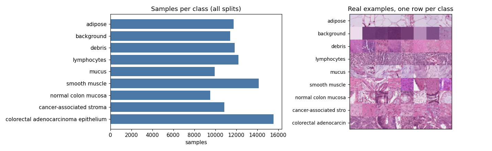
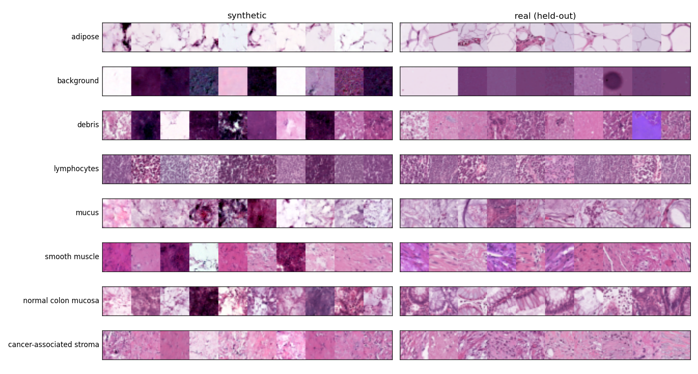
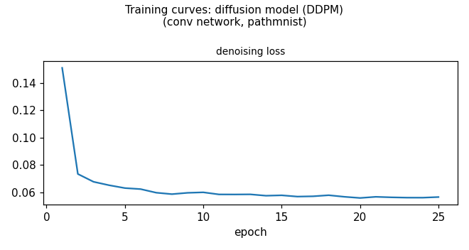

# generated_report_B: PathMNIST — synthetic images to balance tissue classes

**Verdict:** Use with restrictions — the synthetic images gave a small, statistically clear gain for a tissue classifier, but they are visibly imperfect, the original imbalance was mild, and the gain cannot be credited to "balancing" specifically.

## 1. Summary

**Question:** Can synthetic images top up under-represented tissue types and help a downstream tissue classifier?
**Approach:** One class-conditional diffusion model (12 minutes of training), 5,770 synthetic images for the eight smaller classes, compared with plain real data, class re-weighting and random oversampling.
**Result:** Macro-F1 on the independent test set was 0.827 with synthetic data vs 0.808 for the best baseline (interval for the difference: +0.015 to +0.023). But a classifier separates synthetic from real 91% of the time, and only 53% of synthetic images were recognised as the intended tissue.
**Recommendation:** Use as a supplement only (marked synthetic, real validation/test data), not as a substitute for real images; class weights/oversampling add nothing here.

## 2. Data at a glance

- 107,180 colon-pathology patches, 28×28 RGB, nine tissue classes; 89,996 for training, 10,004 validation (same source), 7,180 test (different patients and staining).
- The imbalance is mild: the largest training class (adenocarcinoma epithelium, 12,885) is only 1.64× the smallest (normal colon mucosa, 7,886), below the ~3× level where balancing usually matters.
- Neighbouring pixels are strongly correlated (0.90), so image-aware (convolutional) networks are appropriate.

{width=90%}

## 3. Decision path

| # | Step | Decision | Why |
|:---|:------|:------------------|:-------------------------|
| 1 | Goal | Balancing task; imbalance is mild, likely decline | Largest class is only 1.6 times the smallest; simple fixes probably suffice |
| 2 | Data prep | Scale pixels to [-1, 1], keep image shape | Standard input range for image diffusion models; keeps spatial structure |
| 3 | Model | Conditional diffusion model with conv network | Plenty of image data and we must choose which tissue to generate |
| 4 | Settings | Small diffusion model, 12 minutes training | Probe speed is ~11 steps/s; this fits roughly 8-10k updates in budget |
| 5 | Training check | Training looked healthy | Loss fell smoothly and noise prediction improved at every noise level |
| 6 | Generate | Top up 8 classes to the largest class | Balancing means raising smaller classes to the size of the biggest |
| 7 | Evaluate | Check realism, copying and classifier benefit | Balancing is judged by classifier gain over simple baselines, plus realism |
| 8 | Recommend | Use with restrictions; baselines first | Small classifier gain, but images are visibly imperfect and imbalance is mild |

The turning point was the first decision: because the imbalance is so mild, the question became whether synthetic data beats simple fixes at all, so the baselines were included in the test from the start.

## 4. What was generated

5,770 synthetic 28×28 images from a class-conditional diffusion model, only for the eight classes smaller than adenocarcinoma epithelium (between 156 and 1,111 per class, scaled to the 20,000-image real subset used in the classifier test). Real held-out images are shown for comparison. Synthetic images are recognisable but often darker or more saturated than real ones, and the normal-mucosa samples lack the gland structure of real mucosa.

{width=90%}

## 5. Results

**Downstream classifier (real test set from another collection; average of 3 runs).**

| Training data | Accuracy | Macro-F1 |
|:---|---:|---:|
| Real only | 0.859 | 0.808 |
| Real, class-weighted | 0.854 | 0.799 |
| Real, random oversampling | 0.854 | 0.798 |
| Real + synthetic | 0.877 | 0.827 |

Gain over the best baseline: +0.019 macro-F1 (interval +0.015 to +0.023), well beyond the run-to-run spread of the baseline (0.003). Eight classes were topped up; average F1 on them rose from 0.793 to 0.816.

**Realism and copying (synthetic vs real validation images, same classes).**

| Measure | Synthetic | Real vs real |
|:---|---:|---:|
| Distinguishable from real (classifier accuracy; 0.5 = no) | 0.913 | 0.502 |
| Realism (precision) | 0.60 | 0.96 |
| Coverage (recall) | 0.80 | 0.96 |
| Recognised as intended class | 0.53 | 0.96 |

Recognition was worst for normal colon mucosa (0.23) and cancer-associated stroma (0.42). There was no sign of copying: the nearest real neighbour of a synthetic image was a training image 50.1% of the time (50% expected), with no exact copies.

## 6. Recommendation

**Use with restrictions.** The pre-set criterion (beat the best non-generative baseline with an interval excluding zero) was met, so the synthetic images (`ddpm_conv_ch32/samples_balance.npz`) can supplement classifier training. Restrictions:

- Mark them as synthetic; keep validation and test data real.
- They live in 28×28 pixel space, with images produced at guidance 1.5.
- Label noise: about half of the synthetic images are not recognised as their intended class, so classes such as normal mucosa gain little real information.
- The gain may come from extra data or regularisation rather than balance (see Limitations), and the original imbalance was mild, so class weights or oversampling are not needed.
- No formal privacy guarantee; the copying check is evidence, not proof.

What would change this: a size-matched control (e.g. extra synthetic images of all classes), lower guidance or longer training giving more realistic images, or a more strongly imbalanced real dataset.

## 7. Limitations

- No control isolates balancing from simply adding more (synthetic) data; the real training subset used was 20,000 images.
- The classifier is small and trained for 6 epochs on 3 seeds; the interval covers test-set noise only.
- The realism judge is a small CNN trained on the same data, not a standard pretrained network.
- Training was limited to 12 minutes (about 15.6k steps, 40,000-image subsample); no tuning of guidance or sampling was done, and no second model family was compared.
- The test set comes from a different source, so absolute scores also reflect a source shift.

## Appendix A. Full decision log

1. **Goal** *(objective skill)* — Task = class balancing. Success: recommend synthetic only if real+synthetic macro-F1 beats best of real_only/class-weighted/oversample with paired bootstrap CI excluding 0 and diff > 2 seed SDs; else recommend baseline. Real reference: val for fidelity, test for classifier. Conditioning on y needed. Run one small conditional DDPM to test this empirically since the augment evaluation supplies the baselines.
   - *Evidence:* profile.json: imbalance_ratio_max_over_min=1.64 (<3), smallest class normal colon mucosa n_train=7886, normalized_entropy=0.9949
   - *Alternatives rejected:* Decline outright without evidence: rejected, baselines come with augment evaluation at modest cost
2. **Data prep** *(preprocessing skill)* — --prep scale_pm1, conv backbone, no flattening
   - *Evidence:* profile.json: value_range 0-255, neighbour_pixel_correlation=0.904, no missing values
   - *Alternatives rejected:* mlp/flatten: discards spatial structure
3. **Model** *(model-selection skill)* — conditional DDPM, conv UNet, ch=32; no second family
   - *Evidence:* n_train=89996 >> 5k; image data; need class control (model-selection rule 3)
   - *Alternatives rejected:* cVAE: blurry samples; WGAN-GP: fragile, no specific reason
4. **Settings** *(diffusion skill)* — ch=32, T=1000 cosine, p_uncond=0.1, ema 0.999, lr 2e-4, batch 64, max-train 40000 (stratified), max-minutes 12 (probe used 1; total 13 of 15)
   - *Evidence:* probe train_log: 156 steps in 14.3s on mps; smoke test passed
   - *Alternatives rejected:* ch=64: ~4x slower, too few steps; full 90k train: no benefit within the step budget
5. **Training check** *(diffusion skill)* — Health check passed; stopped by 12-min limit (25 epochs, ~15.6k steps at batch 64)
   - *Evidence:* train_log.json: eps_mse t5=0.229, t25=0.062, t50=0.020, t75=0.0056, t95=0.0007; loss.png plateau ~0.056 without divergence
   - *Alternatives rejected:* none needed
6. **Generate** *(diffusion skill)* — class-counts (20k-subset scale) 782/750/561/552/1084/156/1111/774 for classes 0-7, none for class 8; DDIM 50 steps, guidance 1.5, tag balance; 5770 samples
   - *Evidence:* sample_config_balance.json: 164.2s, non-finite 0; targets scaled from profile.json class_counts_train to the 20,000-image real subset used by the augment test
   - *Alternatives rejected:* guidance 1.0: less class-typical; more samples: no budget
7. **Evaluate** *(evaluation skill)* — Ran fidelity, memorization and augment utility on the balance samples. Criterion met nominally: real+synthetic macro-F1 0.8271 vs best baseline (real_only) 0.8080; diff CI [0.0145,0.0232]; seed SD 0.0007-0.018. But fidelity weak: C2ST 0.913 (ref 0.5015), precision 0.603 / recall 0.802 (ref 0.964/0.962), label consistency 0.5265 (ref 0.9636), mucosa 0.2313. No copying: nearest-train fraction 0.501 (expected 0.5), 0 exact copies. Caveat: no size-matched control, so the gain cannot be attributed to balancing; the real subset was already near balanced (1.64x).
   - *Evidence:* ddpm_conv_ch32/metrics_balance.json
   - *Alternatives rejected:* No further iteration: budget nearly spent (13/15 min); lower guidance resample would not remove the missing size-matched control
8. **Recommend** *(recommendation skill)* — Use with restrictions: samples_balance.npz may supplement training of the tissue classifier (flag as synthetic; keep val/test real); validate on real held-out data from a different source; do not use as a stand-in for real images. Class weights/oversampling are not needed for this mild imbalance and were not better than plain real data.
   - *Evidence:* metrics_balance.json: macro-F1 0.8271 vs 0.8080/0.7988/0.7983 (real_only/class-weighted/oversample); profile.json imbalance 1.64
   - *Alternatives rejected:* Do not use: gain excludes 0 and no copying; Use: fidelity too weak

## Appendix B. Training details

- Conditional diffusion model (small convolutional UNet, 448k parameters in the probe configuration, width 32), 1,000 noise steps with cosine schedule, label dropout 0.1 for guidance, EMA 0.999, learning rate 2e-4, batch 64, 40,000-image stratified training subset.
- Stopped by the 12-minute limit after 25 epochs (721 s); a 1-minute probe used 1 further minute (13 of 15 minutes in total).
- Health check: loss plateaued near 0.056 without divergence; noise-prediction error fell from 0.229 (low noise) to 0.0007 (high noise).
- Sampling: 50 DDIM steps, guidance 1.5, 164 s for 5,770 images.

{width=75%}

## Appendix C. Glossary

- **Macro-F1:** F1 score averaged equally over classes; sensitive to weak classes.
- **Class weighting / oversampling:** non-generative ways of giving small classes more influence in training.
- **Diffusion model (DDPM):** generates images by gradually removing noise; here conditioned on tissue class.
- **Guidance:** a setting that makes generated images more typical of the requested class, at the cost of variety.
- **Precision / recall (of synthetic data):** share of synthetic images that look real / share of real variety covered.
- **Classifier two-sample test:** how well a classifier tells synthetic from real; 0.5 means it cannot.
- **Label consistency:** share of synthetic images a real-trained classifier assigns to the intended class.
- **Paired bootstrap interval:** uncertainty range for a difference in scores, from resampling the test set.

## Appendix D. Reproduce

Tool calls in the order the agent ran them (smoke tests and --help omitted):

```bash
python3 tools/inspect_data.py --data data/pathmnist --out outputs/generated_report_B_pathmnist
python3 tools/train.py --data data/pathmnist --out outputs/generated_report_B_pathmnist/ddpm_probe --model ddpm --backbone conv --prep scale_pm1 --conditional --max-train 20000 --epochs 1 --batch-size 128 --lr 2e-4 --params '{"ch":32,"T":1000,"schedule":"cosine","p_uncond":0.1,"ema_decay":0.999}' --max-minutes 1
python3 tools/train.py --data data/pathmnist --out outputs/generated_report_B_pathmnist/ddpm_conv_ch32 --model ddpm --backbone conv --prep scale_pm1 --conditional --max-train 40000 --epochs 200 --batch-size 64 --lr 2e-4 --params '{"ch":32,"T":1000,"schedule":"cosine","p_uncond":0.1,"ema_decay":0.999}' --max-minutes 12
python3 tools/sample.py --run outputs/generated_report_B_pathmnist/ddpm_conv_ch32 --class-counts '{"0":782,"1":750,"2":561,"3":552,"4":1084,"5":156,"6":1111,"7":774,"8":0}' --steps 50 --guidance 1.5 --tag balance
python3 tools/evaluate.py --run outputs/generated_report_B_pathmnist/ddpm_conv_ch32 --tasks fidelity,memorization,utility --utility augment --samples-tag balance
```
