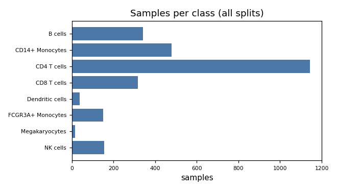
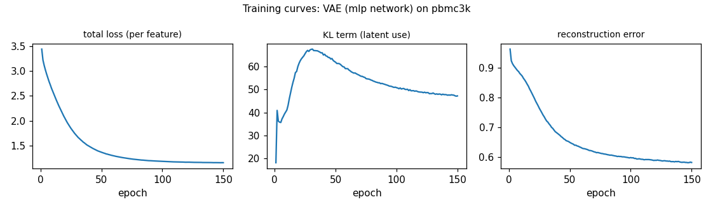

# generated_report_1: PBMC 3k — synthetic cells to rebalance rare cell types
**Verdict:** Synthetic cells from a conditional VAE did not improve cell-type classification of the rare types beyond simple class weighting, so they are not recommended.

## 1. Summary

- **Question:** Can synthetic megakaryocytes and dendritic cells improve a classifier on rare cell types?
- **Approach:** A conditional variational autoencoder (VAE) trained on 1,978 training cells; 200 synthetic cells for each of the two rarest types were added to a logistic-regression classifier and compared with three simple fixes.
- **Result:** Overall accuracy (macro-F1) was 0.903 with synthetic cells versus 0.908 on real data alone; all confidence intervals include 0.
- **Recommendation:** Use class weighting (or real data alone); do not use the synthetic cells.

## 2. Data at a glance

- 2,638 cells × 16,579 genes, raw counts, 95% zeros; cell depth varies 16-fold.
- Eight cell types; imbalance is 76-fold (CD4 T cells 858 training cells vs megakaryocytes 11, dendritic cells 28).
- The held-out test set has only 4 megakaryocytes and 9 dendritic cells, so rare-type scores are anecdotal.
- Genes far outnumber cells (0.16 cells per gene), so the model works on 2,000 highly variable genes (depth-normalised, log-transformed, standardised).

{width=70%}

## 3. Decision path

| # | Step | Decision | Why |
|:---|:------|:------------------|:-------------------------|
| 1 | Goal | Class balancing; generate only if it beats baselines | Rare types are very scarce; simple fixes must be beaten first |
| 2 | Data prep | Normalize, log-transform, keep 2000 top genes | Cells differ in depth, counts are skewed, genes outnumber cells |
| 3 | Model | Conditional VAE | Small data and tiny rare classes suit a VAE |
| 4 | Settings | Latent size 16, 150 epochs, 4 minutes | Small data trains fast; leaves budget for one retry |
| 5 | Training check | Training healthy | All latent dimensions used, loss flattened |
| 6 | Generate | Generate 200 cells each for two rarest types | Balancing target types: megakaryocytes and dendritic cells |
| 7 | Adjust | Resample around real rare cells | Prior samples were rarely recognised as the intended type |
| 8 | Evaluate | Compared with three simple baselines | Synthetic cells must beat simple fixes to be worth using |
| 9 | Recommend | Do not use synthetic cells; use class weights | No measurable gain over simple methods; test counts tiny |

The turning point was the first sampling attempt: cells drawn from the model's prior were recognised as the intended type only 7% of the time, so sampling was redone around real rare cells, which fixed label agreement but not the downstream benefit.

## 4. What was generated
400 synthetic cells (200 megakaryocytes, 200 dendritic cells) in the 2,000-gene standardised log-expression space. They are decoded from the latent codes of random real training cells of that type, with extra spread. They are therefore smoothed variants of 11 and 28 real cells, not new biology.

{width=70%}

*Synthetic cells form tight clumps in the regions of the real rare cells; they do not cover the spread of the few real held-out cells (e.g. the real megakaryocytes at the centre and right are missed).*

## 5. Results

| Measure | Prior sampling | Around real cells | Real-vs-real reference |
|:---|---:|---:|:---|
| Synthetic cells recognised as intended type | 7.3% | 90.5% | 95.3% |
| Coverage of real cells (recall) | 0.31 | 0.00 | — |
| Nearest real cell is a training cell | 0.76 | 0.998 | 0.5 expected |

| Classifier trained on | Macro-F1 | Mean F1, 2 rare types | Megakaryocyte F1 | Dendritic F1 |
|:---|---:|---:|---:|---:|
| Real only | 0.908 | 0.804 | 0.667 | 0.941 |
| Real + class weights | 0.900 | 0.783 | 0.667 | 0.900 |
| Real + random oversampling | 0.892 | 0.754 | 0.667 | 0.842 |
| Real + synthetic | 0.903 | 0.783 | 0.667 | 0.900 |

Differences in macro-F1 (synthetic minus baseline, 95% bootstrap CI): vs real only [−0.030, 0.021]; vs class weights [−0.006, 0.013]; vs oversampling [0.000, 0.033]. All include 0: no demonstrated benefit. Synthetic cells hug the training cells (almost all nearest real neighbours are training cells), expected by construction, and recall of 0 shows they add little diversity beyond the real cells.

## 6. Recommendation
**Do not use the synthetic cells; use class weighting or the real data alone.** Deciding numbers: macro-F1 0.903 vs 0.908 (real only) with CI including 0; megakaryocyte F1 is 0.667 in every arm. Caveats: samples live in standardised log-expression of 2,000 genes, not raw counts, and must be labelled synthetic; the test set stays real; with 4 megakaryocyte and 9 dendritic test cells even large effects could go undetected; no privacy guarantee. More real rare cells, not more synthetic ones, would most plausibly change the verdict.

## 7. Limitations

- Only one model family, one logistic-regression classifier and one seed; one training run used of the 10-minute budget (about 1 minute).
- Rare-class test counts are tiny; labels are a community annotation.
- Feature-space metrics for 13 real cells are noisy; the Fréchet distance is flagged unreliable.


## Appendix A. Full decision log

1. **Goal** *(objective skill)* — Task=class balancing. Generate rare-class cells with a conditional model; recommend synthetic only if real+synthetic macro-F1 (and rare-class F1) beats best of real_only/class-weighted/oversample with paired bootstrap CI excluding 0; otherwise recommend the baseline. Reference: real test split.
   - *Evidence:* imbalance ratio 76.27; Megakaryocytes 11 train, Dendritic 28 train (profile.json)
   - *Alternatives rejected:* decline outright: rejected, imbalance is extreme so worth testing
2. **Data prep** *(preprocessing skill)* — --prep libnorm,log1p,hvg:2000,standardize
   - *Evidence:* row_sum max/min 15.9; skewness 13.9; samples_per_feature 0.159; log1p top2000 variance share 0.689 (profile.json)
   - *Alternatives rejected:* pca: loses gene interpretability; raw counts: model learns depth
3. **Model** *(model-selection skill)* — conditional VAE, mlp backbone, no second family
   - *Evidence:* n_train=1978; smallest class 11 train cells
   - *Alternatives rejected:* ddpm/wgan: need >=5-10k samples; flow: no likelihood needed
4. **Settings** *(vae skill)* — latent_dim 16, hidden [512,256], beta 1, warmup 10, lr 1e-3, bs 64, 150 epochs, max 4 min
   - *Evidence:* smoke test ran OK; budget 10 min
   - *Alternatives rejected:* bigger latent: unnecessary for 8 classes
5. **Training check** *(vae skill)* — No posterior collapse; accept model
   - *Evidence:* active_units 16/16, kl_total 46.8, 52s (train_log.json)
6. **Generate** *(vae skill)* — sample.py --class-counts Mega 200, DC 200, prior latent, tag prior
   - *Evidence:* 400 samples; label consistency 0.0725 vs real 0.953 (metrics_prior.json); macro-F1 diff CIs all include 0
7. **Adjust** *(vae skill)* — Iteration 1: resample with --latent-source posterior --temperature 1.5, tag post
   - *Evidence:* per-class label consistency DC 0.14, Mega 0.005 (metrics_prior.json); recall 0.31
   - *Alternatives rejected:* retrain with lower beta: costs budget, posterior sampling is the documented fix
8. **Evaluate** *(evaluation skill)* — Evaluated fidelity, memorization, augment utility on post samples
   - *Evidence:* label consistency 0.905 (ref 0.953); recall 0.0; nearest-real-is-train 0.9975 (exp 0.5); macro-F1 real+syn 0.9033 vs real_only 0.9079, CI [-0.03,0.021]; vs class-weighted [-0.006,0.013]; test n: DC 9, Mega 4 (metrics_post.json)
9. **Recommend** *(recommendation skill)* — Do not use (use class weighting or real_only). Synthetic cells (samples_post.npz) are smoothed variants of 11 and 28 real cells, no gain; stop iterating.
   - *Evidence:* all macro-F1 diff CIs include 0 (metrics_post.json); Mega F1 0.667 in every arm; model space log-normalized standardized 2000 HVG
   - *Alternatives rejected:* more iterations: unlikely to change verdict given 4 test Mega cells

## Appendix B. Training details
Conditional VAE, MLP [512, 256], latent 16, β=1, 10-epoch KL warm-up, lr 1e-3, batch 64, 150 epochs, 52 s on mps (budget 4 of 10 min; the smoke test is excluded). All 16 latent units active, total KL 46.8, no posterior collapse (train_log.json).

{width=70%}

## Appendix C. Glossary

- **VAE:** a neural network that learns to compress and regenerate cells.
- **Macro-F1:** average over cell types of a balanced accuracy score; 1 is perfect.
- **Recall (coverage):** fraction of real cells that have a synthetic cell nearby.
- **Label consistency:** how often a real-trained classifier agrees with the intended type of synthetic cells.
- **Bootstrap CI:** range of plausible values from resampling test cells.
- **HVG:** highly variable gene.

## Appendix D. Reproduce
Tool calls in the order the agent ran them (smoke tests and --help omitted):

```bash
python3 tools/inspect_data.py --data data/pbmc3k --out outputs/generated_report_1_pbmc3k
python3 tools/train.py --data data/pbmc3k --out outputs/generated_report_1_pbmc3k/cvae_hvg2000_z16 --model vae --backbone mlp --prep libnorm,log1p,hvg:2000,standardize --conditional --epochs 150 --batch-size 64 --lr 1e-3 --params '{"latent_dim":16,"hidden":[512,256],"beta":1.0,"kl_warmup_epochs":10}' --max-minutes 4 --device mps
python3 tools/sample.py --run outputs/generated_report_1_pbmc3k/cvae_hvg2000_z16 --class-counts '{"Megakaryocytes":200,"Dendritic cells":200}' --tag prior
python3 tools/evaluate.py --run outputs/generated_report_1_pbmc3k/cvae_hvg2000_z16 --tasks fidelity,memorization,utility --utility augment --samples-tag prior
python3 tools/log_decision.py --out outputs/generated_report_1_pbmc3k --step sampling --short "Generate 200 cells each for two rarest types" --why "Balancing target types: megakaryocytes and dendritic cells" --decision "sample.py --class-counts Mega 200, DC 200, prior latent, tag prior" --evidence "400 samples
python3 tools/sample.py --run outputs/generated_report_1_pbmc3k/cvae_hvg2000_z16 --class-counts '{"Megakaryocytes":200,"Dendritic cells":200}' --latent-source posterior --temperature 1.5 --tag post
python3 tools/evaluate.py --run outputs/generated_report_1_pbmc3k/cvae_hvg2000_z16 --tasks fidelity,memorization,utility --utility augment --samples-tag post
```
