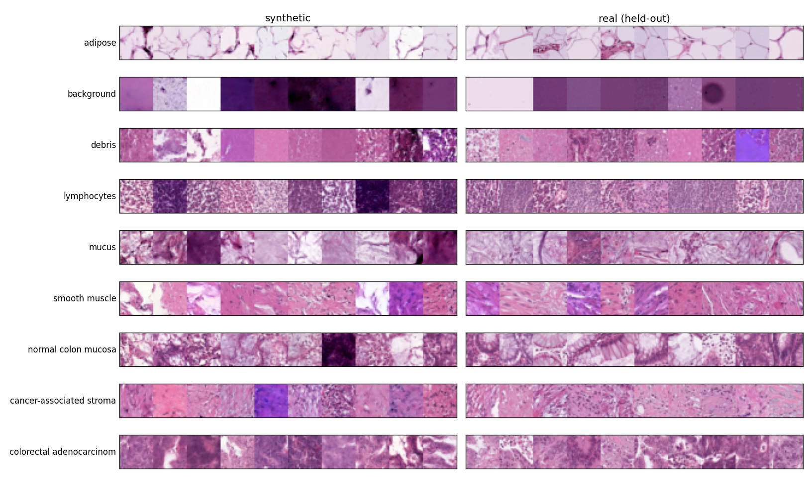
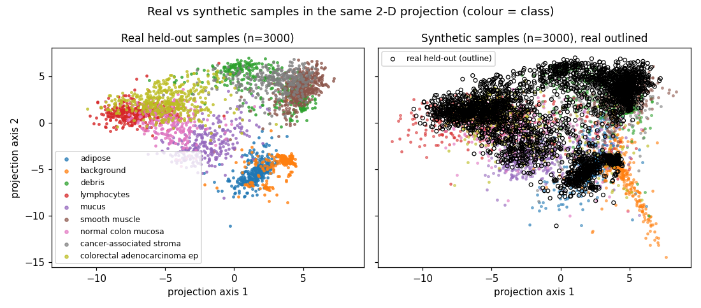
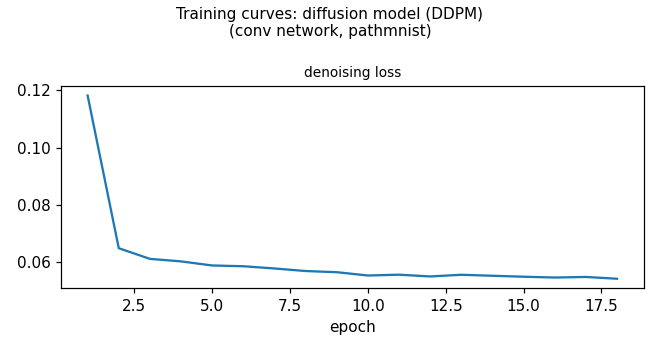

# generated_report_2: PathMNIST — a shareable synthetic, labeled set of tissue images
**Verdict:** The synthetic set (9,000 images, 1,000 per tissue type) shows no sign of copying training images and trains classifiers almost as well as real data, but it is visibly imperfect, so it is suitable for prototyping classifiers only, with restrictions.

## 1. Summary

- **Question:** Can we generate a labeled, realistic, all-tissue-type image set that could be shared in place of private patient patches, without copying them?
- **Approach:** One class-conditional diffusion model trained on all 89,996 training patches (34 minutes), sampled at two class-guidance strengths.
- **Result:** No copying detected (nearest-neighbour test 0.499 vs 0.5 expected; 0 exact copies). Classifiers trained on synthetic data reach 98% of the accuracy of real-trained ones, but the images are still easy to tell from real (detector accuracy 0.84 vs 0.49 for real-vs-real) and only 75% match their intended label.
- **Recommendation:** Use with restrictions: for developing and debugging classifiers, never for final evaluation or clinical claims; no formal privacy guarantee.

## 2. Data at a glance

- 107,180 colon-pathology patches, 28×28 colour pixels, nine tissue types; 89,996 for training, 10,004 validation (same source), 7,180 test (a different collection with other patients and staining).
- Classes are nearly balanced (largest/smallest = 1.64), so balancing is not the issue; the goal is data release.
- Neighbouring pixels are strongly correlated (0.90), so a convolutional model is natural.

{width=90%}

## 3. Decision path

| # | Step | Decision | Why |
|:---|:------|:------------------|:-------------------------|
| 1 | Goal | Release synthetic labeled images; generate | Real patches cannot be shared, so a synthetic stand-in is needed |
| 2 | Data prep | Scale pixels to [-1,1] | Standard input range for image diffusion with convolutions |
| 3 | Model | Conditional diffusion model | Best image quality; plenty of data; labels needed |
| 4 | Settings | Medium network, full data, 34 minutes | Speed test gave about 11k training steps in budget |
| 5 | Training check | Training healthy; samples look tissue-like | Loss flattened and the sample grid resembles real tissue |
| 6 | Generate | 1000 images per tissue type, mild guidance | Balanced labeled set covering all nine tissue types |
| 7 | Evaluate | Evaluated realism, copying, classifier utility | Checks whether shareable data looks real, avoids copies, trains classifiers |
| 8 | Adjust | Try stronger class guidance | Label match is only 75%; stronger guidance may raise it |
| 9 | Evaluate | Stronger guidance: clearer labels, worse realism | Label match rose but diversity and classifier use fell |
| 10 | Recommend | Use for prototyping only, with restrictions | Close to real for training, but visibly imperfect and unproven privacy |

The turning point was the second sampling run: stronger guidance raised label agreement from 75% to 86% but cost realism and classifier usefulness, so the milder setting was kept.

## 4. What was generated

Two synthetic sets of 9,000 labeled 28×28 colour images (1,000 per tissue type): the main one with mild guidance (strength 1.5) and a comparison set with strong guidance (2.5). Synthetic images are stored as 8-bit pixels in the same layout as the real data. Below, each row shows synthetic patches (left) beside held-out real ones (right) for the main set; synthetic patches show plausible stain colours and textures per tissue type, though gland structure in normal mucosa and fine fibre detail in stroma are less convincing, and some backgrounds are noisier than real ones.

{width=90%}

## 5. Results

Metrics compare synthetic data to real validation data; "real-vs-real" is the best achievable value (two real samples against each other). Test images come from a different collection.

| Measure (plain meaning) | Mild guidance (main) | Strong guidance | Real-vs-real |
|:---|:---|:---|:---|
| Copying: nearest real image is a training one (0.5 = no copying) | 0.499 | 0.521 | 0.5 |
| Exact copies of training images | 0 | 0 | – |
| Realism: share of synthetic inside real region (precision) | 0.65 | 0.59 | 0.96 |
| Coverage: share of real variety reproduced (recall) | 0.85 | 0.59 | 0.96 |
| Real-vs-synthetic detector accuracy (C2ST; 0.5 = indistinguishable) | 0.84 | 0.91 | 0.49 |
| Distribution distance (Fréchet; lower is better) | 14.8 | 19.4 | 0.15 |
| Synthetic images recognised as their intended tissue | 0.75 | 0.86 | 0.96 (real) |
| Classifier trained on synthetic, tested on real test set: accuracy relative to real-trained | 0.98 | 0.94 | 1 |
| Same, macro-F1 (synthetic / real-trained) | 0.746 / 0.779 | 0.706 / 0.779 | – |

- **Privacy-style checks pass.** Synthetic images are no closer to training images than held-out real ones are (membership fraction 0.499; median nearest distance 4.42 vs 4.06 for real held-out). Strong guidance is also clean.
- **Utility is good but not equal.** For the main set the macro-F1 shortfall is 0.034 (95% CI of the difference −0.042 to −0.024), which is statistically real but modest; training runs vary by about 0.025. Synthetic-trained classifiers did well on adipose, background, lymphocytes and mucus, but poorly on smooth muscle (recall 0.28 vs 0.61 for real-trained) and debris (0.50 vs 0.69).
- **Labels are the weak point.** Only 75% of images were recognised as intended; normal mucosa (0.59) and cancer stroma (0.55) are weakest. Strong guidance raised this to 86% but narrowed coverage and made images easier to flag as synthetic.

{width=90%}

## 6. Recommendation

**Use with restrictions.** Share the main set (9,000 images, mild guidance) for developing and debugging tissue classifiers, clearly marked as synthetic. Deciding numbers: no copying signal (0.499 vs 0.5, 0 exact copies), classifier accuracy 0.98 of real-trained, but detector accuracy 0.84 and label agreement 0.75.

Caveats: do not use it for final model evaluation, performance claims or clinical conclusions, and keep a real test set; users should expect roughly a quarter of labels to be questionable, especially normal mucosa and stroma, and weaker smooth-muscle and debris detection; images are 28×28 only; the checks are evidence, not a formal privacy guarantee (no differential privacy), so a privacy review is still advised before release. What would change the verdict: longer training or a larger model (budget stopped training at about 11,000 steps), label filtering with a classifier trained on real data, or a formal privacy audit.

## 7. Limitations

- Training was stopped by the time limit; quality could improve with more steps.
- Memorization is measured in pixel space on subsets of 3,000 images; it cannot rule out subtler leakage.
- Classifier utility uses one small network, 6 epochs, 3 seeds; the real-collection test set differs in source, so gaps mix generation quality with domain shift.
- Only two guidance strengths and one model were compared.

## Appendix A. Full decision log

1. **Goal** *(objective skill)* — Task: synthetic data release. Success: TSTR accuracy >= 0.8x train-on-real, C2ST clearly below 1, frac_nearest_real_is_train near 0.5, no exact copies, all 9 classes label-consistent. Reference: val (same source); test (other collection) for classifier tests. Conditional on y.
   - *Evidence:* profile.json: 9 classes, imbalance ratio 1.64, n_train=89996, 28x28x3
   - *Alternatives rejected:* Decline: not applicable, no non-generative way to share data
2. **Data prep** *(preprocessing skill)* — --prep scale_pm1, conv backbone, no flattening; stratified subsample via --max-train decided after probe
   - *Evidence:* profile.json: values 0-255, neighbour correlation 0.904
   - *Alternatives rejected:* mlp/flatten: loses spatial structure
3. **Model** *(model-selection skill)* — conditional DDPM, conv UNet, ch 32 pending probe
   - *Evidence:* n_train=89996 >> 5k; smallest class 7886
   - *Alternatives rejected:* cVAE: blurry; WGAN-GP: fragile; flow: weak samples
4. **Settings** *(diffusion skill)* — ddpm conv ch48, T1000 cosine, p_uncond 0.1, ema 0.999, bs128, lr2e-4, full train set (no subsample), --max-minutes 34 (probe 1 min counted; total 35 <= 40)
   - *Evidence:* probe/train_log.json: 27.4s per 157 steps (~5.7 steps/s) => ~11.6k steps in 34 min
   - *Alternatives rejected:* ch32: lower quality; ch64: too few steps
5. **Training check** *(diffusion skill)* — Stopped by time limit at 34 min, 18 epochs (~11.2k steps). Loss 0.118->0.054 plateau; eps_mse falls from 0.22 (t5) to 0.0006 (t95); no noise/saturation in probe grid; weaker on normal mucosa glands.
   - *Evidence:* ddpm_ch48/train_log.json, loss.png, sample_grid_probe.png
   - *Alternatives rejected:* longer training: budget spent
6. **Generate** *(diffusion skill)* — 9000 samples (1000/class), DDIM 50 steps, guidance 1.5, eta 0, tag rel; probe of 20/class took 8.8s
   - *Evidence:* ddpm_ch48/sample_config_probe.json
   - *Alternatives rejected:* guidance 1.0: less class-typical; higher guidance: lower diversity
7. **Evaluate** *(evaluation skill)* — fidelity,memorization,utility(tstr) on samples_rel. Memorization clean (0.499 vs 0.5, 0 exact copies); TSTR/TRTR acc 0.977 but macro-F1 gap -0.042..-0.024 (significant); C2ST 0.84 vs 0.49 ref: clearly distinguishable; label consistency 0.75 vs 0.96 real, weakest normal mucosa 0.59 and stroma 0.55; precision 0.65, recall 0.85.
   - *Evidence:* ddpm_ch48/metrics_rel.json
   - *Alternatives rejected:* -
8. **Adjust** *(evaluation skill)* — Resample 1000/class with guidance 2.5 (tag g25), same 50 DDIM steps, re-evaluate; no retraining
   - *Evidence:* metrics_rel.json label_consistency 0.752, weak classes mucosa 0.588, stroma 0.547
   - *Alternatives rejected:* retrain: budget spent (35 of 40 min)
9. **Evaluate** *(evaluation skill)* — g25: label consistency 0.861 (vs 0.752), but recall 0.587 (vs 0.846), C2ST 0.911 (vs 0.845), Frechet 19.4 (vs 14.8), TSTR macro-F1 0.706 (vs 0.746; real 0.779), TSTR/TRTR acc 0.936 (vs 0.977). Memorization still clean (0.521, 0 copies). Keep guidance 1.5 as release set.
   - *Evidence:* ddpm_ch48/metrics_g25.json vs metrics_rel.json
   - *Alternatives rejected:* no further iteration: budget spent, remaining options unlikely to change verdict
10. **Recommend** *(recommendation skill)* — Use with restrictions: share ddpm_ch48/samples_rel.npz (9000 images, 1000/class, 28x28 RGB uint8, labeled synthetic) for classifier prototyping/method development; not for final evaluation, clinical claims, or replacing real test sets; no formal privacy guarantee. Expect ~25% label noise (esp. mucosa, stroma); smooth muscle and debris weak when transferred to the other-source test set.
   - *Evidence:* metrics_rel.json: TSTR/TRTR acc 0.977, macro-F1 0.746 vs 0.779; memorization 0.499, 0 copies; C2ST 0.845; label consistency 0.752
   - *Alternatives rejected:* g25 set: better labels but worse utility; do not release: no memorization or utility failure

## Appendix B. Training details

- Model: class-conditional diffusion (small convolutional U-Net, ~1.0M parameters, base width 48, 1000 noise steps, cosine schedule, label dropout 0.1, EMA 0.999), batch 128, learning rate 2e-4, full training set, pixels scaled to [−1, 1].
- Stopped by the 34-minute limit after 18 epochs (2,042 s); a separate 1-minute speed probe was also run (total 35 of 40 minutes).
- Loss fell from 0.118 to 0.054 and plateaued (curve below). Noise-prediction error fell from 0.22 (early steps) to 0.0006 (late steps), as expected; no noise or saturation in the sample grid.
- Sampling: 50 deterministic DDIM steps; 9,000 images took about 7 minutes per set.

{width=75%}

## Appendix C. Glossary

- **Diffusion model (DDPM):** generates images by gradually denoising random noise, guided by a class label.
- **Guidance:** a dial that makes images more typical of the requested class at the cost of diversity.
- **Precision / recall:** share of synthetic images lying in the real-data region / share of real variety covered.
- **C2ST:** accuracy of a classifier trying to separate real from synthetic; 0.5 means it cannot.
- **Fréchet distance:** distance between real and synthetic feature distributions; 0 is identical.
- **Memorization check:** whether synthetic images sit closer to training images than to held-out real images.
- **TSTR:** train on synthetic, test on real.
- **Macro-F1:** average per-class F1 score, treating all classes equally.
- **Label consistency:** how often a real-data classifier recognises a synthetic image as its intended class.
- **EMA:** averaged copy of model weights used for sampling.

## Appendix D. Reproduce

Tool calls in the order the agent ran them (smoke tests and --help omitted):

```bash
python3 tools/inspect_data.py --data data/pathmnist --out outputs/generated_report_2_pathmnist
python3 tools/train.py --data data/pathmnist --out outputs/generated_report_2_pathmnist/probe --model ddpm --backbone conv --prep scale_pm1 --conditional --epochs 1 --batch-size 128 --lr 2e-4 --params '{"ch":48,"T":1000,"schedule":"cosine","p_uncond":0.1,"ema_decay":0.999}' --max-train 20000 --max-minutes 1
python3 tools/train.py --data data/pathmnist --out outputs/generated_report_2_pathmnist/ddpm_ch48 --model ddpm --backbone conv --prep scale_pm1 --conditional --epochs 100 --batch-size 128 --lr 2e-4 --params '{"ch":48,"T":1000,"schedule":"cosine","p_uncond":0.1,"ema_decay":0.999}' --max-minutes 34 > outputs/generated_report_2_pathmnist/train_stdout.txt
pgrep -f tools/train.py
until ! pgrep -f tools/train.py
until ! pgrep -f tools/train.py
until ! pgrep -f tools/train.py
until ! pgrep -f tools/train.py
until ! pgrep -f tools/train.py
until ! pgrep -f tools/train.py
pgrep -f tools/train.py
python3 tools/sample.py --run outputs/generated_report_2_pathmnist/ddpm_ch48 --n-per-class 20 --steps 50 --guidance 1.5 --tag probe
python3 tools/sample.py --run outputs/generated_report_2_pathmnist/ddpm_ch48 --n-per-class 1000 --steps 50 --guidance 1.5 --tag rel
python3 tools/evaluate.py --run outputs/generated_report_2_pathmnist/ddpm_ch48 --tasks fidelity,memorization,utility --utility tstr --samples-tag rel
python3 tools/sample.py --run outputs/generated_report_2_pathmnist/ddpm_ch48 --n-per-class 1000 --steps 50 --guidance 2.5 --tag g25
python3 tools/evaluate.py --run outputs/generated_report_2_pathmnist/ddpm_ch48 --tasks fidelity,memorization,utility --utility tstr --samples-tag g25
```
