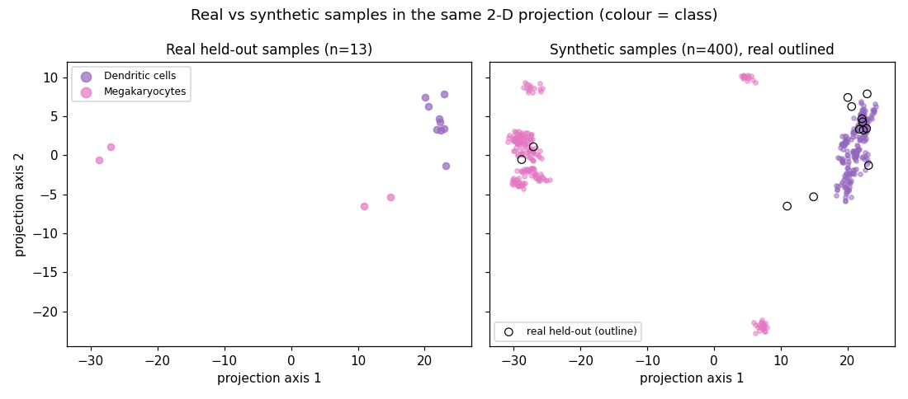

# Building an AI Agent for Generative Modeling

## 1. System Architecture Overview

Generative models such as VAEs, GANs, normalizing flows and diffusion models can create synthetic data for many purposes: sharing data that cannot be released for privacy reasons, rebalancing rare classes, or scoring how typical a sample is for analomies. However, whether generation is the right tool at all, which model fits, how to configure it within a time budget, and above all whether the generated data are actually *useful* depend on both the dataset and what the user wants to do with it. This project builds an AI agent that makes these decisions itself: given a dataset and a plain-language objective, a large language model (LLM) inspects the data, interprets the objective, chooses and trains a model, evaluates the samples against real data, recommends whether and how they should be used, and writes the report. The design keeps the two-layer structure of Project 1 (inspired by Lecture 9, AI agents) and is summarized below in Figure 1.

{width="90%"}

**Decision layer**: `AGENTS.md` defines the workflow (inspect → interpret objective → preprocess → choose model → configure → train → sample → evaluate → iterate → recommend → report) and a few hard rules. Nine skill files in `.agents/skills/` hold the *criteria* for each decision: one each for the objective, preprocessing, model selection, evaluation and recommendation, and one per model family (VAE, GAN, flow, diffusion) with its settings and training health checks. As in Project 1, they are a reasoning framework, not a lookup table, and never mention PBMC3K or PathMNIST.

**Compute layer** (`tools/`, no decision logic): `inspect_data.py` profiles the data; `train.py` fits one of four model families under a hard time limit; `sample.py` draws class-specific samples; `score.py` gives per-sample likelihoods; `evaluate.py` computes every metric next to a *real-vs-real* reference. `log_decision.py` records each decision with its evidence and rejected alternatives, and the report's decision table, decision log and "Reproduce" commands are generated from that log.

Three rules keep the system honest and reusable: (1) the agent may never edit `tools/`, which contain no dataset-specific code; (2) every reported number must come from a file a tool wrote, never from the LLM's memory; (3) models see only the training split, and held-out data stay real (synthetic data never replaces a test set).

## 2. Agent Decision-Making

**Interpret the objective, and decide whether to generate at all.** The objective skill maps the user's wording to a task type (data release, class balancing, augmentation, anomaly screening, representation learning, ...), which fixes what "success" means and how it is measured. Before training, the agent must write down a falsifiable success criterion, e.g. "recommend synthetic data only if it beats the best non-generative baseline with a confidence interval excluding 0". The skill also says when generation is the *wrong* tool (e.g. imbalance below \~3× rarely needs it; class weighting and oversampling must always be tried first), and declining with evidence is a valid outcome.

**Choose the model family.** The model-selection skill compares the four families from class (VAE, WGAN-GP, RealNVP flow, DDPM) on likelihood, sample quality, data needs, stability and compute, then applies rules in order: a per-sample likelihood is needed (anomaly screening) → flow; samples from small data (a class with only tens of examples) → conditional VAE; high-quality images with plenty of data → conditional DDPM with classifier-free guidance.

**Configure within a time budget.** The family skill gives starting hyperparameters and trade-offs. The agent runs a one-minute speed probe, converts it into the number of training steps it can afford, and sizes the network so that it reaches enough steps ( \~10k for a DDPM) within the budget. After training it applies the family's health checks (posterior collapse, mode collapse, noise-level error curves).

**Evaluate against references, and iterate.** The evaluation skill chooses metrics that answer the objective: *realism* (precision/recall, Fréchet distance, and a classifier two-sample test: can a classifier tell real from synthetic?), *label correctness* (does a real-trained classifier recognize the intended class?), *copying* (is a synthetic sample's nearest real neighbor a training sample more often than the expected 50%?), and *usefulness* (train-on-synthetic-test-on-real, or real+synthetic vs class weighting/oversampling, over 3 seeds with paired bootstrap CIs). Its central rule is that no metric is read alone: each sits next to the same metric computed between two *real* samples, the best value achievable at that sample size. If a metric points to a fixable weakness, the agent changes the sampler or settings and re-evaluates (at most three times).

**Recommend.** The recommendation skill forces one of four verdicts (*Use*, *Use with restrictions*, *Do not use (use X instead)*, *Can't tell*), each with the 2–3 deciding numbers, the exact downstream use and what would change it.

**NOTE:** As in Project 1, these decisions are LLM reasoning over evidence, not a fixed program, and the same skills produced different workflows for different objectives, even on the same dataset (§4).

## 3. Tools and Models

**Language model**: Claude Sonnet 5.5, run non-interactively through Claude Code (`claude -p`) by `run_agent.sh`. It makes every analytical decision and writes the generated reports; it may only use shell and file tools and cannot edit `tools/`. The launcher streams a live progress view and exports the PDF as a safety net.

**The generative models** are implemented from scratch in PyTorch, one per lecture: a conditional **VAE** (L14) that can also sample around real training samples (important for very rare classes), a conditional **WGAN-GP** (L15), a **RealNVP flow** (L16) with exact log-likelihood, and a conditional **DDPM** (L17) with a small U-Net, EMA weights, fast DDIM sampling and classifier-free guidance. Each has an MLP (tabular) and a convolutional (image) backbone and runs on the Apple-silicon GPU (MPS). **Evaluation** uses scikit-learn logistic regression for tabular data and a small CNN trained on real images as the judge and downstream classifier. **Data and reporting**: `scanpy` and `medmnist` in each dataset's `prepare.py`, `matplotlib`, and `pandoc` + `typst`.

## 4. Experimental Results

*(NOTE: full decision logs, metrics, training curves and exact commands are in `generated_report_1` and `generated_report_2`; `appendix/generated_report_B` is an extra PathMNIST run with a different objective.)*

|   | Report 1: PBMC3K | Report 2: PathMNIST | Extra B: PathMNIST |
|:-----------------|:-----------------|:-----------------|:-----------------|
| Objective | Rebalance rare cell types | Shareable synthetic labeled images | Balance tissue classes |
| Model chosen | Conditional VAE | Conditional DDPM, width 48, 34 min | Conditional DDPM, width 32, 12 min |
| Iteration | Resampled around real rare cells: intended type recognized 7% → 90% | Stronger guidance: labels 75% → 86% but realism and utility worse; kept mild | None; baselines included from the start |
| Deciding numbers | Macro-F1 0.903 vs 0.908 real only (all CIs include 0) | No copying (0.499 vs 0.5); accuracy 98% of real-trained; detectable (0.84 vs 0.49) | +0.019 macro-F1 vs best baseline (CI +0.015 to +0.023); detectable (0.91 vs 0.50) |
| Verdict | Do not use; use class weights | Use with restrictions (prototyping) | Use with restrictions (supplement) |

**Table 1**: What the agent decided on each run. "Detectable" = accuracy of a real-vs-synthetic classifier, next to its real-vs-real reference.

**PBMC3K (class balancing).** Cell depth varied 16-fold and genes outnumbered cells, so the agent normalized, log-transformed and kept the 2,000 most variable genes. With only 11 and 28 training cells in the two rarest types, the rules ruled out DDPMs and GANs and chose a conditional VAE. The turning point was the first evaluation: only 7% of synthetic megakaryocytes and dendritic cells were recognized as the intended type (95% for real cells). Following the VAE skill, the agent resampled around real rare cells, raising this to 90%, but the synthetic cells still did not beat real data alone or class weighting. It therefore recommended *against* them, describing them honestly as "smoothed variants of 11 and 28 real cells, not new biology" (Figure 2).

{width="90%"}

**PathMNIST (synthetic data release).** Here the goal was sharing, so the agent focused on copying checks and train-on-synthetic utility. With \~90,000 images and strongly correlated neighboring pixels, it chose a convolutional conditional DDPM, and a one-minute probe showed it could afford a width-48 network for \~11,000 steps. There was no sign of copying, and classifiers trained only on synthetic images reached 98% of real-trained accuracy, but only 75% of images were recognized as their intended tissue. Stronger guidance raised that to 86% at the cost of coverage and utility, so the agent kept the milder setting and recommended the set for classifier prototyping only (Figure 3).

{width="90%"}

**Same data, different objective.** Given PathMNIST with a *balancing* objective (run B), the agent noted that the imbalance was only 1.64×, below the \~3× rule, so it included class weighting and oversampling from the start and trained a smaller DDPM to fit a 15-minute budget. Synthetic data gave a small but clear gain, which it recommended as a supplement only. Runs 2 and B show that the objective, not just the dataset, drives the model size, the samples, the metrics and the verdict.

## 5. Strengths and limitations

**Strengths** - The system is autonomous from one command: given a dataset, an objective and a budget, it decides whether to generate, what to generate and how to judge it. Its choices changed for the right reasons: a VAE for tiny cell populations, a DDPM for plentiful images, a smaller model for a smaller budget, different metrics for sharing than for balancing. Its evaluation resists over-optimism: every metric has a real-vs-real reference, synthetic data must beat simple baselines, and the agent actually reached "do not use". Every number traces to a file, each generated report ends with the exact commands to reproduce it, and adding a dataset needs only a `prepare.py` and a short `DATA.md`.

**Limitations** - As in Project 1, the LLM's decisions are not fully repeatable across runs. Verdicts also depend on the evaluation tools being good judges: an earlier version of run B concluded "do not use" largely because its judging classifier was weak and its reference images came from a different hospital, and the verdict changed once both were fixed; the agent cannot detect such flaws in its own tools. Budgets were short (12–34 minutes), so the DDPMs stopped early on 28×28 images. The PBMC3K test set has only 4 megakaryocytes and 9 dendritic cells, too few to show a benefit even if one existed. The copying checks are also just evidence, not a formal privacy guarantee.

## References

1.  D. P. Kingma and M. Welling, "Auto-Encoding Variational Bayes," *ICLR*, 2014.
2.  I. Gulrajani et al., "Improved Training of Wasserstein GANs," *NeurIPS*, 2017.
3.  L. Dinh, J. Sohl-Dickstein, and S. Bengio, "Density Estimation using Real NVP," *ICLR*, 2017.
4.  J. Ho, A. Jain, and P. Abbeel, "Denoising Diffusion Probabilistic Models," *NeurIPS*, 2020.
5.  J. Song, C. Meng, and S. Ermon, "Denoising Diffusion Implicit Models," *ICLR*, 2021.
6.  J. Ho and T. Salimans, "Classifier-Free Diffusion Guidance," *NeurIPS Workshop*, 2021.
7.  T. Kynkäänniemi et al., "Improved Precision and Recall Metric for Assessing Generative Models," *NeurIPS*, 2019.
8.  D. Lopez-Paz and M. Oquab, "Revisiting Classifier Two-Sample Tests," *ICLR*, 2017.
9.  F. A. Wolf, P. Angerer, and F. J. Theis, "SCANPY: large-scale single-cell gene expression data analysis," *Genome Biology*, 2018.
10. J. Yang et al., "MedMNIST v2 — A large-scale lightweight benchmark for 2D and 3D biomedical image classification," *Scientific Data*, 2023.
