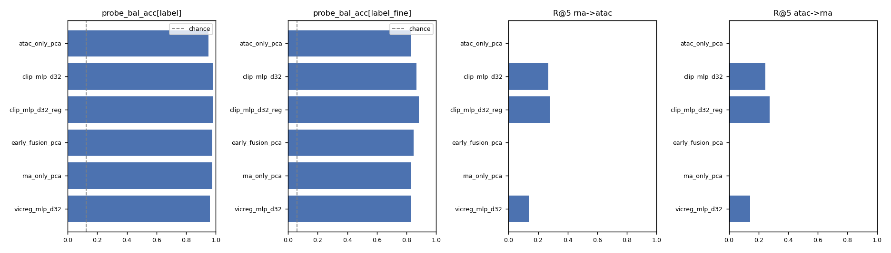
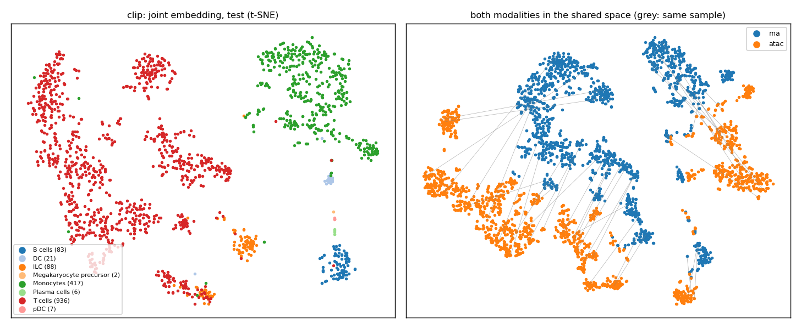

# generated_report_1: PBMC Multiome — a joint RNA+ATAC cell representation

**Verdict:** Multimodal helps: a jointly trained RNA+ATAC embedding identifies fine cell types better than either modality alone (+0.05 balanced accuracy, CI excludes 0), but a plain concatenate-and-compress baseline is statistically indistinguishable from it, and predicting ATAC from RNA works barely better than guessing the average.

## 1. Summary

- **Question:** Can one embedding of RNA and ATAC identify cell types at least as well as either modality alone, and how well can each modality be predicted from the other?
- **Approach:** Compact RNA and ATAC summaries, then a contrastive model (CLIP-style, no labels used) that pulls the two views of each cell together; compared with each modality alone, simple concatenation, and a non-contrastive alternative (VICReg).
- **Result:** On 17 fine cell types the joint embedding scores 0.884 balanced accuracy vs 0.831 (RNA alone) and 0.833 (ATAC alone); ATAC→RNA prediction beats the average-profile baseline (r 0.466 vs 0.300), RNA→ATAC barely does (AUROC 0.671 vs 0.661).
- **Recommendation:** Use the joint embedding when both modalities exist; concatenation + PCA is a near-equal, simpler choice. Treat RNA→ATAC prediction as weak.

## 2. Data at a glance

- 10,405 nuclei from one healthy donor, both modalities measured in the same cell: 25,598 genes (94% zeros) and 111,698 chromatin peaks (92% zeros). Split 7,285 train / 1,560 validation / 1,560 test.
- Labels: 8 coarse and 17 fine cell types, predicted by a reference classifier from **RNA only**, so they favour RNA-based representations. Several fine classes have under 10 test cells (e.g. 2 megakaryocyte precursors, 5 CD16− NK, 6 plasma, 7 pDC) and cannot be judged individually.
- Imbalanced: 60% of test cells are T cells; the largest fine class (helper T cells, 573 test cells) is also the hardest.

{width=90%}

*Left: training cells per coarse type (very uneven). Middle/right: total counts per cell for RNA and ATAC.*

## 3. Decision path

| # | Step | Decision | Why |
|:---|:------|:------------------|:-------------------------|
| 1 | Goal | Classify cell types; predict each modality from other | Objective names joint cell-type identification and cross-modal prediction; no label training mentioned |
| 2 | Data prep | Standard reductions per modality, plus prediction targets | RNA is overdispersed counts; ATAC is near-binary and sparse, so each gets its usual treatment |
| 3 | Combine modalities | Contrastive alignment vs early-fusion baselines | Paired cells and cross-prediction goal need aligned spaces; baselines show if learning helps |
| 4 | Settings | Mid-size networks, 32 dims, 8 min each | Small data, fast epochs; budget split between main and alternative models |
| 5 | Training check | CLIP overfits early; VICReg weaker matching | Validation loss rose after epoch 11 while training loss kept falling |
| 6 | Adjust | Retrain CLIP with stronger regularisation | First CLIP run overfit quickly |
| 7 | Evaluate | Regularised CLIP best learned model on val | Beat both single modalities and early fusion on fine cell types; retrieval far above chance |
| 8 | Downstream | Cell-type probe and cross-modality prediction | These are the two analyses the objective asked for |
| 9 | Recommend | Use aligned CLIP embedding for cell types | It beats each modality alone on fine cell types; early fusion is a close, simpler rival |

The turning point was the first contrastive run: it overfit after 11 epochs (fine-type accuracy on validation 0.832); stronger regularisation lifted it to 0.900 on validation and made it the chosen model.

## 4. Methods compared

- **RNA alone / ATAC alone:** the 32 leading principal components of each modality's standard summary (no learning, no labels).
- **Early fusion:** both summaries standardised, stacked, and compressed to 32 components.
- **Joint embedding (CLIP-style, chosen):** one small neural network per modality, trained so a cell's RNA and ATAC embeddings are closest to each other among all cells in a batch (contrastive learning). No labels used. The version with heavier regularisation was chosen on validation data.
- **Joint embedding (VICReg):** same idea without negative pairs; the alternative.
- Models were chosen on validation (fine-type accuracy 0.900 for the chosen model vs 0.880 early fusion, 0.868 VICReg, 0.849 RNA alone, 0.818 ATAC alone); test data were used only for the final numbers.

## 5. Results

Test set, 1,560 cells. Chance is 0.059 (fine) and 0.125 (coarse) balanced accuracy.

| representation | coarse types (8) | fine types (17) |
|:---|:---|:---|
| RNA alone | 0.977 | 0.831 |
| ATAC alone | 0.951 | 0.833 |
| Early fusion (concatenate + PCA) | 0.976 | 0.849 |
| **Joint embedding (CLIP-style)** | **0.983** | **0.884** |
| Joint embedding (VICReg) | 0.960 | 0.827 |

Paired differences on fine types (same test cells, 95% CI): joint vs RNA alone **+0.053 [+0.015, +0.087]**; joint vs ATAC alone **+0.051 [+0.011, +0.096]**; joint vs early fusion +0.035 [−0.000, +0.075] (cannot be told apart). On coarse types all differences from RNA alone include 0. VICReg shows no gain over RNA alone (−0.004 [−0.036, +0.025]).

{width=90%}

*Bars: probe accuracy for coarse and fine types, and top-5 cross-modal retrieval in each direction (only models with a shared space have retrieval bars). The joint CLIP-style models are highest on fine types.*

{width=90%}

*Left: test cells in the joint embedding coloured by coarse type; monocytes, B cells and T cells form separate groups, T cells split into several sub-clouds. Right: RNA (blue) and ATAC (orange) embeddings of the same cells largely occupy overlapping regions but are not co-located cell by cell.*

## 6. Downstream analyses

### 6.1 Cell-type identification
A linear classifier trained on training-cell embeddings labels test cells. The joint embedding reaches 0.884 balanced accuracy on fine types (RNA 0.831, ATAC 0.833, chance 0.059) and 0.983 on coarse types. Best handled large classes: classical monocytes (recall 0.96) and CD16+ NK (0.98). Weakest large class: Tcm/Naive helper T cells (573 cells, recall 0.61 — vs 0.60 RNA alone and 0.56 ATAC alone), which are hard to separate from neighbouring T subtypes in every representation. Clustering with k-means (not the objective's focus) is not better for the joint model: ARI 0.281 vs 0.425 for RNA alone, so its types are separable by a linear classifier but not grouped as compact clusters.

### 6.2 Predicting one modality from the other
A ridge regression from the source modality's embedding predicts the other modality. **ATAC→RNA** (2,000 variable genes): per-cell correlation 0.466 with the joint model's ATAC encoder, 0.457 with ATAC alone, 0.300 for always predicting the training average. The joint model's gain over ATAC alone is statistically clear (+0.009 [+0.008, +0.011]) but small. Per gene the correlation averages only 0.118, and 13.5% of genes exceed 0.3. **RNA→ATAC** (10,000 most common peaks, open/closed): per-cell AUROC 0.671 vs 0.661 for the average baseline, per-peak AUROC 0.597 vs 0.5 chance; the joint model and RNA alone are indistinguishable (difference +0.000 [−0.000, +0.000]). Cross-modal matching of single cells is far above chance (fraction of cells ranked ahead of the true partner 0.024 vs 0.5; true partner in the top 5 of 1,560 for 28% of cells vs 0.3% chance) but is a coarse, cell-type-level match.

## 7. Recommendation

For cell-type identification when both modalities are available, use the joint CLIP-style embedding: it beats RNA alone (+0.053 [+0.015, +0.087]) and ATAC alone (+0.051 [+0.011, +0.096]) on fine types and matches them on coarse types. Because its edge over early fusion has a CI touching 0 (+0.035 [−0.000, +0.075]), concatenation + PCA is an acceptable simpler alternative. When only one modality is measured, either alone does equally well on fine types here. For cross-modal prediction, ATAC→RNA is modestly informative; RNA→ATAC is not useful beyond the average profile. Caveats: labels were predicted from RNA, one donor, tiny classes unresolved, and the joint model is worse than PCA baselines for k-means clustering. More donors, labels not derived from RNA, or a larger test set would change the strength of this conclusion.

## 8. Limitations

- One donor and one dataset; no external replication.
- Labels come from an RNA-based reference classifier, so they underestimate how much ATAC could add.
- Test classes with fewer than ~10 cells (several fine types) carry no individual conclusion; balanced accuracy is noisy (CI width ≈ 0.08).
- Only a few model configurations were tried, and both prediction tasks use a simple ridge regression on 32-dimensional embeddings, which limits per-gene accuracy.

## Appendix A. Full decision log

1. **Goal** *(objective skill)* — Tasks: (1) integration/classification: probe balanced accuracy on label_fine (primary; 17 classes) and label (coarse, 8 classes), joint vs RNA-alone vs ATAC-alone vs pca_concat; (2) cross-modal prediction rna->atac and atac->rna via evaluate cross. Labels NOT used in training (label-free clip primary). Success: joint probe bal-acc on label_fine >= best single modality with paired-difference CI not below 0 (>= means 'at least as well'); 'helps' only if CI excludes 0 positive. Prediction: per-sample Pearson r (RNA target) / AUROC (ATAC target) CI above train-mean baseline. Labels come from CellTypist on RNA only so favour RNA; classes <10 test cells (pDC 7, Plasma 6, Mk 2 etc.) uninterpretable individually.
   - *Evidence:* profile.json: test n=1560, label 8 classes smallest train 11, label_fine 17 classes; DATA.md label source RNA
   - *Alternatives rejected:* supcon_clip rejected: labels not allowed for training in objective
2. **Data prep** *(preprocessing skill)* — rna: log1p_hvg2000_pca50 (encoder input); atac: tfidf_lsi50_drop1 (first LSI comp corr with depth 0.856 -> dropped, 49 dims). Targets: rna log1p_hvg2000 (Pearson), atac binary_top10000 (AUROC).
   - *Evidence:* profile.json: rna 94.2% zeros, overdispersion 1.23, 68% nonzeros=1; atac 91.8% zeros, 72% nonzeros<=2, 10% =1; features/*.json: rna PCA var 0.333, atac LSI var 0.067
   - *Alternatives rejected:* lsi100/pca100 deferred unless fine-label probe weak
3. **Combine modalities** *(fusion skill)* — Baselines: rna_only_pca, atac_only_pca (pca_concat single input), early_fusion_pca (pca_concat both). Primary: clip with mlp encoders dim 32, label-free. Alternative: vicreg mlp dim 32.
   - *Evidence:* n_train=7285 (>2000, so clip ok); many same-type cells -> false-negative risk motivates vicreg comparison
   - *Alternatives rejected:* supcon_clip rejected: labels not allowed; simclr: single modality only
4. **Settings** *(training skill)* — clip mlp d32 hidden256 layers2 dropout0.1 batch512 lr1e-3 wd1e-4, max 8 min; vicreg same with batch 256, max 5 min; 7 min kept for iteration. Total max <= 20. Smoked clip OK (R@1 above chance 1/1560).
   - *Evidence:* smoke run val R@1 0.006-0.009, loss decreasing
   - *Alternatives rejected:* bigger dim rejected: bigger not better at n~1e4
5. **Training check** *(training skill)* — clip_mlp_d32: best_epoch 11/31, early stop, val R@1 0.137 vs chance ~0.0006; train loss 1.8 vs val 3.7 -> overfitting. vicreg_mlp_d32: best epoch 59/79, val R@1 0.053. Both took <0.3 min. Iterate on clip with more regularisation.
   - *Evidence:* train_log.json / run_config.json summary of each run
   - *Alternatives rejected:* none
6. **Adjust** *(training skill)* — clip_mlp_d32_reg: hidden128 dropout0.3 wd1e-3, max 4 min (total budget used <= 8+5+4=17)
   - *Evidence:* clip_mlp_d32 best_epoch 11/31
   - *Alternatives rejected:* fewer layers
7. **Evaluate** *(evaluation skill)* — val label_fine probe bal-acc: clip_mlp_d32_reg 0.900, early_fusion_pca 0.880, vicreg 0.868, rna_only 0.849, atac_only 0.818, clip_mlp_d32 0.832 (overfit). Coarse label ~0.98 for all joint models vs RNA 0.976, ATAC 0.827. clip_reg FOSCTTM 0.024 (chance 0.5), R@5 ~0.27 vs 0.003. Cross: atac->rna per-cell r 0.466 vs baseline 0.30; rna->atac per-cell AUROC 0.672 vs mean baseline 0.661 (small). Chosen for test: clip_mlp_d32_reg; also test baselines rna_only, atac_only, early_fusion and vicreg (alternative).
   - *Evidence:* comparison_val.md
   - *Alternatives rejected:* early_fusion_pca is simpler; kept as strongest-baseline reference on test; k-means ARI best for pca baselines
8. **Downstream** *(recommendation skill)* — Classification: test label_fine probe bal-acc clip_reg 0.884 vs rna 0.831, atac 0.833, early fusion 0.849 (chance 0.059); coarse 0.983 vs 0.977/0.951/0.976. Weakest large class: Tcm/Naive helper T (n=573) recall 0.61 clip_reg, 0.60 rna, 0.56 atac. Prediction: atac->rna per-cell r 0.466 (clip_reg encoder) vs 0.457 (ATAC alone) vs 0.300 train-mean baseline; per-feature r 0.118, 13.5% genes r>0.3. rna->atac per-cell AUROC 0.671 vs 0.661 baseline, per-feature AUROC 0.597 (0.5 chance): weak. Retrieval FOSCTTM 0.024 (chance 0.5), R@5 0.28 vs 0.003.
   - *Evidence:* comparison_test.md, comparison_test_vs_*.md, clip_mlp_d32_reg/metrics.json, rna_only_pca/metrics.json, atac_only_pca/metrics.json
   - *Alternatives rejected:* none
9. **Recommend** *(recommendation skill)* — Verdict: Multimodal helps (vs single modalities). Use clip_mlp_d32_reg joint embedding for annotation when both modalities exist; early_fusion_pca is within CI (+0.035 [-0.000,+0.075]) and simpler. For prediction: ATAC->RNA clear gain over mean baseline (r 0.466 vs 0.300), RNA->ATAC negligible. Caveats: labels from RNA via CellTypist; one donor; small classes uninterpretable; k-means ARI not better than PCA baselines.
   - *Evidence:* label_fine test: clip_reg 0.884 vs RNA 0.831 diff +0.053 [+0.015,+0.087]; vs ATAC 0.833 +0.051 [+0.011,+0.096]; vs early fusion +0.035 [-0.000,+0.075]
   - *Alternatives rejected:* early_fusion_pca; vicreg (no gain: 0.827)

## Appendix B. Training details

- Chosen model: CLIP-style, 2-layer MLP encoders (hidden 128, dropout 0.3, weight decay 1e-3), 32 dimensions, batch 512; stopped early at epoch 147 with best epoch 127; 0.23 min; validation top-1 retrieval 0.141.
- First CLIP run (hidden 256, dropout 0.1): best epoch 11 of 31, overfit (train loss 1.8 vs val 3.7); 0.07 min.
- VICReg: best epoch 59 of 79, 0.27 min, validation top-1 retrieval 0.053.
- Budgeted maxima 8 + 5 + 4 = 17 of 20 minutes. No collapse: no dead dimensions; effective rank of the chosen joint embedding 9.4 of 32; modality gap 0.12.

{width=90%}

## Appendix C. Glossary

- **Balanced accuracy (linear probe):** average per-class recall of a linear classifier fit on training-cell embeddings.
- **Contrastive learning (CLIP-style):** training to make matching pairs similar and non-matching pairs dissimilar.
- **VICReg:** a non-contrastive alternative that keeps matched pairs close while preventing collapse.
- **PCA / LSI:** linear compression to a few components (LSI is the version used for ATAC).
- **Early fusion:** concatenating modalities before compressing.
- **Paired bootstrap CI:** 95% interval for a difference between two models scored on the same cells.
- **ARI:** agreement of k-means clusters with labels (0 random, 1 perfect).
- **FOSCTTM:** average fraction of cells ranked closer than the true partner (0 perfect, 0.5 random).
- **AUROC:** probability a truly open peak is scored above a closed one (0.5 chance).
- **Pearson r:** correlation of predicted and observed values.

## Appendix D. Reproduce

Tool calls in the order the agent ran them (smoke tests and --help omitted):

```bash
python3 tools/inspect_data.py --data data/pbmc_multiome --out outputs/generated_report_1_pbmc_multiome
```
