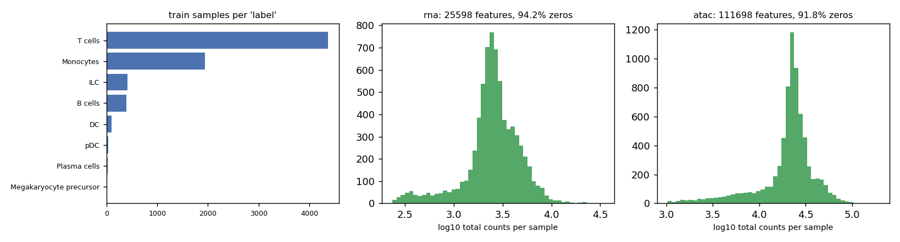
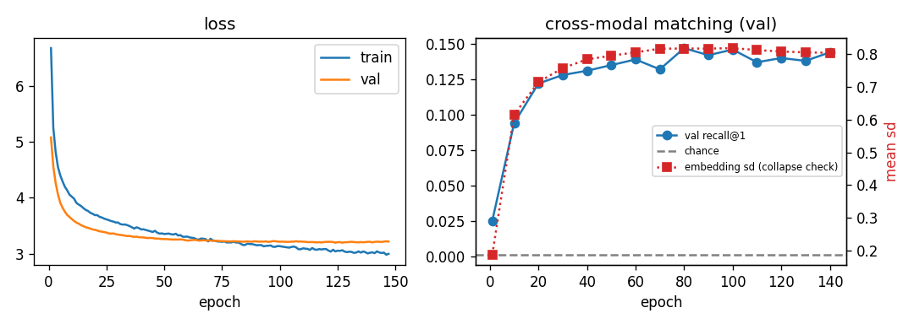

# generated_report_1: PBMC Multiome — joint RNA+ATAC cell representation

**Verdict:** A joint RNA+ATAC embedding identifies cell types at least as well as either modality alone (no proven gain) and additionally lets one modality be matched to the other, but predicting one modality from the other is only modestly better than guessing the average cell.

## 1. Summary

- **Question:** Can one embedding of RNA and chromatin accessibility (ATAC) find cell types as well as either alone, and how well can each modality be predicted from the other?
- **Approach:** Label-free contrastive training (CLIP-style) of two small neural encoders on 7,285 cells, compared with each modality alone and a simple combine-then-reduce baseline; scored on 1,560 held-out cells.
- **Result:** Fine cell types: 0.88 balanced accuracy (joint) vs 0.85 (RNA) and 0.84 (ATAC) — higher, but the 95% intervals overlap. Matching a cell's ATAC to its RNA: correct partner in top 5 of 1,560 for 28% of cells (chance 0.3%).
- **Recommendation:** Use the joint embedding when both modalities are needed (annotation plus cross-modal matching); the simple combined PCA is statistically indistinguishable for annotation alone. Verdict category: *multimodal enables*.

## 2. Data at a glance

- 10,405 nuclei from one healthy donor, RNA (25,598 genes) and ATAC (111,698 peaks) measured in the same cells; split 7,285 / 1,560 / 1,560 (train / validation / test).
- Both matrices are very sparse (94% and 92% zeros). ATAC depth tracks the first principal axis (correlation 0.86), so that axis was dropped.
- Labels: 8 coarse and 17 fine cell types, predicted from RNA by a reference classifier, so they favour RNA. Classes are very uneven: T cells 936 test cells, but 2–7 for the rarest three.

{width=90%}

## 3. Decision path

| # | Step | Decision | Why |
|:---|:------|:------------------|:-------------------------|
| 1 | Goal | Joint cell typing plus cross-modal prediction | Objective names cell-type identification first, then predicting each modality from other |
| 2 | Data prep | Standard RNA and ATAC reductions | Counts are sparse; depth-normalised, compact inputs train faster and denoise |
| 3 | Combine modalities | CLIP-style alignment, VICReg as alternative | Cells are paired and prediction across modalities needs a shared space |
| 4 | Settings | Default settings sized to 7k cells | Small inputs train in minutes; defaults are standard for this size |
| 5 | Training check | CLIP overfits early; VICReg healthier | CLIP validation loss rose after epoch 11 while training loss kept falling |
| 6 | Evaluate | All learned models match RNA on coarse labels | Coarse cell types are easy; fine types separate the methods slightly |
| 7 | Adjust | Regularise CLIP (dropout, smaller network) | Original CLIP overfit and joint trailed early fusion on fine types |
| 8 | Encoder + loss | Choose regularised CLIP as main model | Best fine-type score and best cross-modal matching on validation |
| 9 | Downstream | Cell typing and cross-modal prediction run | These are the two analyses the objective asked for |
| 10 | Recommend | Use regularised joint CLIP; RNA PCA if cheap | Joint matches or beats each modality and adds cross-modal matching |

The turning point was step 7: the first CLIP model overfit after ~11 epochs and trailed the simple baseline on fine types (0.83 vs 0.88 on validation); a smaller, more strongly regularised network raised it to 0.90.

## 4. Methods compared

- **RNA only / ATAC only (baselines):** principal-component reduction of one modality to 32 dimensions.
- **Early fusion (baseline):** standardise both modalities, concatenate, reduce to 32 dimensions; no learning.
- **Joint contrastive model (main, label-free):** one small network per modality, trained so that a cell's RNA and ATAC embeddings are close and other cells' are far (CLIP-style, 32 dimensions). Its joint embedding averages the two modality embeddings. No labels were used in training.
- **Joint non-contrastive model (alternative):** same networks trained with a variance/decorrelation objective (VICReg) instead of negatives.
- Choices were made on validation data; test data were used only after the choice.

## 5. Results

Test set, 1,560 cells. Chance balanced accuracy is 0.125 (coarse) and lower for fine types; cross-modal top-5 chance is 0.003.

| Representation | Coarse types (bal. acc.) | Fine types (bal. acc., 95% CI) | ATAC→RNA per-cell r | RNA→ATAC per-cell AUROC | Top-5 match RNA→ATAC |
|:---|:---|:---|:---|:---|:---|
| RNA only | 0.977 | 0.831 [0.794, 0.867] | – | 0.671 | – |
| ATAC only | 0.951 | 0.833 [0.790, 0.875] | 0.457 | – | – |
| Early fusion (PCA) | 0.976 | 0.849 [0.811, 0.885] | – | – | – |
| **Joint contrastive (main)** | **0.983** | **0.884 [0.858, 0.908]** | 0.466 | 0.671 | 0.28 |
| Joint VICReg | 0.960 | 0.827 [0.785, 0.858] | 0.476 | – | 0.14 |
| Train-mean baseline | – | – | 0.300 | 0.661 | 0.003 (chance) |

{width=90%}

{width=90%}

## 6. Downstream analyses

### 6.1 Cell-type identification
A linear classifier trained on the training cells' embeddings was scored on test cells. The joint contrastive embedding reaches 0.884 balanced accuracy on fine types versus 0.852 for its own RNA part, 0.838 for its ATAC part and 0.849 for early fusion; coarse types are near ceiling for everything except ATAC alone (0.951). The joint model's interval [0.858, 0.908] overlaps the best single modality's [0.815, 0.880], so "at least as well" is met but "better" is not proven. Since the labels came from RNA, a tie was the most one could expect. The 2–7-cell classes carry no conclusion.

### 6.2 Predicting each modality from the other
A ridge regression from one modality's embedding predicts the other. ATAC→RNA: mean per-cell correlation 0.466 [0.458, 0.474] versus 0.300 for always predicting the average cell and 0.457 for ATAC-only PCA; only 13.5% of genes have per-gene correlation above 0.3. RNA→ATAC (on-or-off for 10,000 common peaks): per-cell AUROC 0.671 vs 0.661 for the average-cell baseline; per-peak AUROC 0.597 (0.5 = guessing). So expression is partly recoverable from chromatin, but peak-level prediction from RNA is weak, and the joint model gives little extra over plain PCA here.

### 6.3 Cross-modal matching (extra)
For 28% of cells the true partner modality is in the top 5 of 1,560 (chance 0.3%); the average true partner is ahead of 97.6% of candidates (FOSCTTM 0.024). Only the aligned models can do this.

## 7. Recommendation

Use the regularised joint contrastive embedding when both modalities are measured and either cell annotation or cross-modal matching is wanted (fine types 0.884 vs 0.852 for the best single modality; matching 0.28 vs 0.003 chance). For annotation alone, early-fusion PCA (0.849) or RNA PCA are statistically indistinguishable and simpler. Caveats: labels derive from RNA, one donor, and the joint-vs-single difference rests on overlapping intervals. Evidence that would change this: labels independent of RNA (e.g. protein-based) or more donors showing a clear ATAC contribution.

## 8. Limitations

- One donor and one assay run; no batch generalisation tested.
- Labels are RNA-derived predictions, favouring RNA and capping what ATAC can add.
- Rare classes (2–7 test cells) cannot be assessed; the primary comparison uses all classes equally weighted.
- Single seed per model; the regularisation fix was chosen on validation after seeing a weakness, a small tuning step.

## Appendix A. Full decision log

1. **Goal** *(objective skill)* — Primary: classification/integration on label_fine (17 classes) and label (8); joint vs RNA alone vs ATAC alone, probe balanced accuracy + macro-F1. Secondary: cross-modal prediction rna->atac (binary_top10000, AUROC) and atac->rna (log1p_hvg2000, Pearson r) vs train-mean baseline. No labels in training (label-free). Success: joint probe bal. acc. on label_fine >= best single modality (CI overlap or better = 'at least as well'); prediction clearly above train-mean baseline. Labels come from RNA (CellTypist) so joint can at best tie RNA; tiny classes (<10 test cells) not conclusive.
   - *Evidence:* profile.json: n_train=7285; label classes 8, label_fine 17; smallest train class 11
   - *Alternatives rejected:* supcon_clip: rejected, objective does not allow labels for training
2. **Data prep** *(preprocessing skill)* — rna: log1p_hvg2000_pca50 (encoder input); atac: tfidf_lsi50_drop1 (72% nonzeros<=2, 92% zeros, ATAC-like; first LSI comp corr with depth r=0.86 so dropped, 49 dims). Targets: rna log1p_hvg2000 (Pearson r), atac binary_top10000 (AUROC).
   - *Evidence:* profile.json atac frac_le_2=0.72; features/atac__tfidf_lsi50_drop1.json corr=0.856; rna PCA50 explained var 0.333, atac 0.067
   - *Alternatives rejected:* lsi100/pca100: only if fine-label probe weak
3. **Combine modalities** *(fusion skill)* — Baselines: rna_only_pca, atac_only_pca, early_fusion_pca (dim 32). Primary: clip with mlp encoders dim 32, label-free. One alternative: vicreg (many same-type look-alike cells are false negatives for contrastive loss).
   - *Evidence:* n_train=7285 paired; objective includes cross-modal prediction
   - *Alternatives rejected:* supcon_clip: labels not allowed; simclr: single modality
4. **Settings** *(training skill)* — clip: mlp hidden256 x2, dim 32, batch 512, lr 1e-3, dropout 0.1, epochs 300 patience 20, max 8 min. vicreg: batch 256, max 5 min. Total planned 13 of 20 min, 7 kept for iteration.
   - *Evidence:* smoke runs OK (train_log.json); n_train=7285
   - *Alternatives rejected:* larger dim: not needed for 8 classes
5. **Training check** *(training skill)* — clip: best_epoch 11 of 31, train loss 1.82 vs val 3.68 at epoch 30, val R@1 0.137 (chance ~0.001); effective rank 12.8/32 on val. vicreg: best_epoch 59 of 79, val R@1 0.053, eff rank 8.4/32. No collapse (sd>0). Action: rerun clip with stronger regularisation.
   - *Evidence:* clip_mlp_d32/train_log.json, run_config.json summary; metrics_val.json collapse
   - *Alternatives rejected:* accept as is: overfit symptom matches training-skill rule (best_epoch <=10% ... borderline)
6. **Evaluate** *(evaluation skill)* — val probe bal acc label: rna 0.976, atac 0.827, early fusion 0.980, clip 0.981, vicreg 0.984. label_fine: rna 0.849, atac 0.818, early fusion 0.880, clip joint 0.832, vicreg joint 0.868 (CIs ~±0.04, overlapping). Cross: atac->rna per-cell r clip 0.463, vicreg 0.475, atac-only 0.456 vs train-mean 0.30; rna->atac per-feature AUROC ~0.60 for all. Retrieval: clip R@5 0.27, FOSCTTM 0.025 (chance R@5 0.003); vicreg R@5 0.13. Joint CLIP is not above early fusion on label_fine -> iterate on CLIP regularisation.
   - *Evidence:* comparison_val.md, metrics_val.json
   - *Alternatives rejected:* -
7. **Adjust** *(training skill)* — clip_mlp_d32_reg: hidden 128, dropout 0.3, weight decay 1e-3. Trained 0.29 min (best epoch 127 of 147, no early overfit). Val label_fine joint probe 0.900 (was 0.832; early fusion 0.880; rna 0.849); label 0.979; retrieval R@5 0.276/0.265, FOSCTTM 0.024; atac->rna r 0.466. Total training minutes used ~0.7 of 20.
   - *Evidence:* comparison_val.md; clip_mlp_d32_reg/metrics_val.json, train_log.json
   - *Alternatives rejected:* vicreg regularised: not needed, vicreg retrieval 2x worse
8. **Encoder + loss** *(evaluation skill)* — Report on test: clip_mlp_d32_reg (primary, label-free), vicreg_mlp_d32 (alternative), baselines rna_only_pca, atac_only_pca, early_fusion_pca. Original clip_mlp_d32 dropped (superseded).
   - *Evidence:* comparison_val.md
   - *Alternatives rejected:* early_fusion_pca: close on label_fine (0.880) but gives no cross-modal map
9. **Downstream** *(recommendation skill)* — Test (n=1560). label_fine probe bal acc: clip joint 0.884 [0.858,0.908]; RNA enc 0.852 [0.815,0.880]; ATAC enc 0.838; rna_only 0.831; atac_only 0.833; early fusion 0.849; vicreg joint 0.827. label: clip joint 0.983, rna_only 0.977, atac_only 0.951. atac->rna per-cell r 0.466 [0.458,0.474] vs atac_only 0.457 [0.448,0.465] vs train-mean 0.300; per-gene r>0.3 for 13.5% genes. rna->atac per-sample AUROC 0.671 vs train-mean 0.661, per-peak AUROC 0.597 (0.5 chance); rna_only 0.599. Retrieval R@5 0.28/0.27 vs chance 0.003, FOSCTTM 0.024 (0.5 chance).
   - *Evidence:* comparison_test.md; */metrics.json
   - *Alternatives rejected:* -
10. **Recommend** *(recommendation skill)* — Verdict: Multimodal enables. Joint CLIP embedding is at least as good as either modality for cell types (fine 0.884 vs best single 0.852, CIs overlap, so no proven gain) and uniquely supports cross-modal matching (R@5 0.28 vs 0.003). Prediction of each modality from the other is only modestly above the train-mean baseline (ATAC->RNA r 0.466 vs 0.300; RNA->ATAC per-sample AUROC 0.671 vs 0.661). Caveats: labels predicted from RNA by CellTypist, one donor, tiny classes (2-7 test cells), early fusion PCA is within CI. Would change: RNA-independent labels, more donors.
   - *Evidence:* comparison_test.md, metrics.json files
   - *Alternatives rejected:* early_fusion_pca: simpler and within CI on label_fine

## Appendix B. Training details

- Joint contrastive (final): two-layer networks, hidden 128, dropout 0.3, weight decay 1e-3, batch 512, 32 dimensions; stopped early at epoch 147 (best epoch 127), 0.29 min. Validation top-1 matching 0.141. Effective rank (val) 9.5/32, no collapse.
- First joint contrastive run (hidden 256, dropout 0.1) overfit: best epoch 11 of 31, train loss 1.82 vs validation 3.68. Superseded.
- VICReg: batch 256, best epoch 59 of 79, 0.27 min.
- Total training time under 1 minute of the 20-minute budget. Loss curves: `loss.png` in each model folder.

{width=90%}

## Appendix C. Glossary

- **Balanced accuracy:** mean recall over cell types, so rare types count equally.
- **Linear probe:** a linear classifier trained on frozen embeddings.
- **CLIP-style contrastive:** pulls paired samples together and pushes others apart.
- **VICReg:** alignment without negatives, keeping dimensions varied and decorrelated.
- **ATAC / LSI:** chromatin accessibility; LSI is its standard dimension reduction.
- **AUROC:** probability a random "on" peak ranks above a random "off" one (0.5 = chance).
- **FOSCTTM:** average fraction of candidates closer than the true partner (0 perfect, 0.5 random).
- **Effective rank:** number of embedding directions actually used.
- **Early fusion:** concatenating modalities before reducing.

## Appendix D. Reproduce

Tool calls in the order the agent ran them (smoke tests and --help omitted):

```bash
python3 tools/inspect_data.py --data data/pbmc_multiome --out outputs/generated_report_1_pbmc_multiome
```

The auto-extracted history captured only the first command. The remaining commands (same order, `O=outputs/generated_report_1_pbmc_multiome`, `D=data/pbmc_multiome`):

```bash
python3 tools/preprocess.py --data $D --out $O --modality rna --spec log1p_hvg2000_pca50
python3 tools/preprocess.py --data $D --out $O --modality atac --spec tfidf_lsi50_drop1
python3 tools/preprocess.py --data $D --out $O --modality rna --spec log1p_hvg2000
python3 tools/preprocess.py --data $D --out $O --modality atac --spec binary_top10000
python3 tools/train.py --data $D --out $O/rna_only_pca --inputs rna:log1p_hvg2000_pca50 --method pca_concat --dim 32
python3 tools/train.py --data $D --out $O/atac_only_pca --inputs atac:tfidf_lsi50_drop1 --method pca_concat --dim 32
python3 tools/train.py --data $D --out $O/early_fusion_pca --inputs rna:log1p_hvg2000_pca50,atac:tfidf_lsi50_drop1 --method pca_concat --dim 32
python3 tools/train.py --data $D --out $O/vicreg_mlp_d32 --inputs rna:log1p_hvg2000_pca50,atac:tfidf_lsi50_drop1 --method vicreg --dim 32 --encoder mlp --batch-size 256 --epochs 300 --patience 20 --max-minutes 5
python3 tools/train.py --data $D --out $O/clip_mlp_d32_reg --inputs rna:log1p_hvg2000_pca50,atac:tfidf_lsi50_drop1 --method clip --dim 32 --encoder mlp --hidden 128 --dropout 0.3 --weight-decay 1e-3 --batch-size 512 --epochs 300 --patience 20 --max-minutes 5
python3 tools/evaluate.py --data $D --run $O/clip_mlp_d32_reg --split test --tasks structure,retrieval,collapse,cross --labels label,label_fine --cross "rna->atac:binary_top10000,atac->rna:log1p_hvg2000"
python3 tools/compare_runs.py --out $O --split test
```
(The other models were evaluated analogously; the first CLIP run used the defaults with `--max-minutes 8`.)
