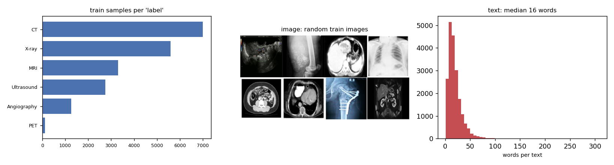
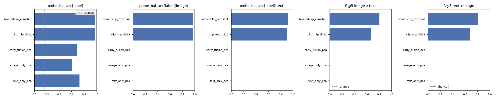

# generated_report_2: ROCOv2 radiology figures — shared image–caption space for retrieval and modality classification

**Verdict:** No measurable gain from training: the frozen, pretrained BiomedCLIP model already matches captions to images and identifies the imaging modality best, and our fine-tuning could not improve on it (it may be flattered by having seen this kind of data).

## 1. Summary

- **Question:** Can we learn a shared image–caption representation that retrieves the right caption for an image (and vice versa) and classifies imaging modality from the image?
- **Approach:** Compared frozen BiomedCLIP, two light fine-tunes of it (no labels used in training), and simple pixel / word-count baselines.
- **Result:** Frozen BiomedCLIP puts the true caption in the top 5 of 2,000 for 81% of images (chance 0.25%) and classifies modality from the image with 0.972 balanced accuracy; fine-tuning did not beat it.
- **Recommendation:** Use the frozen BiomedCLIP image and text encoders for retrieval, and its image encoder with a linear classifier for modality; no training needed.

## 2. Data at a glance

- Two modalities on the same 24,000 figures: the image (median 296×256 px, 70% grayscale) and its caption (median 16 words). Split 20,000 train / 2,000 validation / 2,000 test; test papers differ from train papers.
- Label: imaging modality, 6 classes (CT, X-ray, MRI, Ultrasound, Angiography, PET). The test set is 36% CT; PET has only 13 test images and is too few to interpret alone.
- Captions often give the label away: a classifier on words alone reaches 0.91 balanced accuracy (chance 0.17), so classification is judged from the image side only.

{width=90%}

## 3. Decision path

| # | Step | Decision | Why |
|:---|:------|:------------------|:-------------------------|
| 1 | Goal | Retrieval first, image modality classification second | Objective names caption retrieval then modality classification; labels only for scoring |
| 2 | Data prep | Use BiomedCLIP features plus simple baselines | Pretrained biomedical encoder matches the domain; simple features show what it buys |
| 3 | Combine modalities | Fine-tune BiomedCLIP lightly; keep baselines | Pretrained model already aligns image and text; small fix may help |
| 4 | Settings | Gentle settings, 8 + 5 minute budget | Start near a strong model; move slowly; keep minutes in reserve |
| 5 | Training check | Adapter never beat the pretrained start | Matching got worse though loss fell; original model was kept |
| 6 | Adjust | Retried adapter with 10x smaller step | First attempt never beat the pretrained start; skill allows one retry |
| 7 | Evaluate | Pretrained model wins on val | Fine-tuning did not help; zero-shot is already very strong |
| 8 | Downstream | Retrieval and image classification scored on test | Objective asks for both; zero-shot is the strongest model |
| 9 | Recommend | Use frozen BiomedCLIP as is | Training added nothing; the pretrained model is already strongest |

The turning point was step 5: training the light fine-tune made the training loss fall but the matching of captions to images on validation data got worse, so the original pretrained model was kept — twice.

## 4. Methods compared

- **BiomedCLIP zero-shot** — the pretrained biomedical image and text encoders used as they are; they already share one space.
- **Fine-tuned BiomedCLIP** (not tested separately) — a small correction layer started at the pretrained model, trained to improve matching. Two learning rates were tried; both ended at the unchanged pretrained model, so on test it is identical to zero-shot.
- **Retrained projection (MLP)** — new two-layer networks trained from scratch on the BiomedCLIP features with a contrastive objective (matching pairs pulled together).
- **Image alone / text alone** — simple features (32×32 pixels or word TF-IDF) reduced by PCA to 32 dimensions.
- **Early fusion** — those two simple feature sets concatenated and reduced to 32 dimensions.

No labels were used for training. Models were chosen on validation; the test set was scored once for the models above. The single-modality and early-fusion baselines have no shared space, so they cannot retrieve.

## 5. Results

Test set, 2,000 images. "Image→caption" asks: for an image, is its caption among the top 5 of 2,000 candidates (chance 0.25%)? Modality classification uses the image embedding alone (chance 0.167).

| Model | Image→caption top-5 | Caption→image top-5 | Modality from image (balanced acc.) |
|:---|:---|:---|:---|
| BiomedCLIP zero-shot | 0.808 | 0.808 | 0.972 |
| Retrained projection (MLP) | 0.675 | 0.682 | 0.973 |
| Image alone (pixels, PCA) | – | – | 0.605 |
| Early fusion (joint embedding; image-only score not defined) | – | – | 0.694 (joint) |
| Text alone (words, PCA; joint embedding) | – | – | 0.730 (text; not valid evidence for images) |

Paired differences against zero-shot (95% CI):

- Retrained projection, image→caption: −0.133 [−0.152, −0.114]; caption→image: −0.126 [−0.146, −0.108] — clearly worse.
- Retrained projection, modality from image: +0.001 [−0.006, +0.008] — no difference.
- Image alone: −0.367 [−0.391, −0.343] — far worse.

{width=90%}

The bars show the pretrained models and the retrained projection far above the simple baselines for classification, and the pretrained zero-shot highest for both retrieval directions; blank bars mean the baseline does not provide that quantity.

## 6. Downstream analyses

### 6.1 Retrieving the right caption (and image)
A caption (or image) is the query; we rank all 2,000 test partners by cosine similarity. For zero-shot, the true caption is first for 50% of images (top 5: 81%, 95% CI 79–82%; top 10: 88%) and the median rank is 2; the reverse direction is the same (top 5: 81%). Chance for top 5 is 0.25%. The retrained projection is 13 points lower. Images of the same modality are easy to confuse; the embedding figure shows class structure but we did not inspect individual misses.

### 6.2 Classifying modality from the image
A linear classifier trained on training-set image embeddings. Zero-shot image embeddings give 0.972 balanced accuracy (95% CI 0.964–0.979; chance 0.167). Recall is ≥ 0.965 for Angiography, CT, MRI and Ultrasound; X-ray is the weakest large class (0.904, 565 images). PET (13 images) is not interpretable alone.

{width=90%}

Left: classes form distinct groups, with X-ray the most spread out and PET a tiny cluster. Right: images and captions sit in two separate clouds (centroid distance 0.80), yet retrieval still works because the nearest caption is chosen by ranking.

## 7. Recommendation

Use the **frozen BiomedCLIP** encoders as the shared image–caption representation: for retrieval (top-5 about 0.81 each way) and, via its image embedding with a linear classifier, for modality classification (0.972). Fine-tuning gave no gain (adapter runs reverted to the pretrained model; the retrained projection is 0.13 worse at retrieval and equal for classification, difference +0.001 [−0.006, +0.008]). Verdict: no measurable gain from training; the simpler frozen model is preferred.

Caveats: BiomedCLIP was pretrained on figure–caption pairs from PubMed Central, the same source as ROCOv2, so its scores may be inflated by overlap — this cannot be measured here. The label (modality) is often named in the caption, so text-side classification is not evidence. What would change this: a test on figures from outside PubMed Central, or fine-tuning with far more data or compute than the 20-minute budget (only about 1 minute was used).

## 8. Limitations

- Only a 20,000-pair training subset and 2,000-image test set; PET has 13 test images.
- Two learning rates were tried for the light fine-tune and one setting for the retrained projection; other settings may behave differently.
- Retrieval among 2,000 candidates is easier than among a full archive.
- The fine-tune runs were not scored on test because they equal zero-shot by construction (validation numbers are identical).
- Misses were not inspected visually.

## Appendix A. Full decision log

1. **Goal** *(objective skill)* — Tasks: (1) image<->text retrieval, headline recall@5 both directions + FOSCTTM; (2) modality classification from IMAGE embedding, headline probe balanced accuracy (label 'label', 6 classes). No labels in training (label-free). Baselines: image alone, text alone, pca_concat early fusion, BiomedCLIP zero-shot identity. Success: tuned model's i2t and t2i recall@5 exceed zero-shot's by paired CI excluding 0, and image-probe bal. acc not below zero-shot image probe. Text-side classification not used (text shortcut). PET has 13 test samples: uninterpretable alone.
   - *Evidence:* profile.json: text predicts label from words bal.acc 0.91 (chance 0.17); 42% captions name the label; test PET n=13; n_train 20000
   - *Alternatives rejected:* supcon_clip: labels not granted for training, rejected
2. **Data prep** *(preprocessing skill)* — image:biomedclip and text:biomedclip (512-d, shared space, cached) for encoders and zero-shot; image:pixels32_pca50 and text:tfidf_svd128 as simple baselines. No caption cleaning.
   - *Evidence:* features/*.json: 24000 rows each; profile.json 70% grayscale images, median 16 words
   - *Alternatives rejected:* No cross-modal prediction targets: objective does not ask for them
3. **Combine modalities** *(fusion skill)* — Primary: clip with adapter encoders on biomedclip features, dim 512, select-by val_recall (light fine-tuning). Alternative: clip with mlp projection heads on same features. Baselines: image-only pca, text-only pca, pca_concat early fusion, biomedclip zero-shot identity. Label-free.
   - *Evidence:* val zero-shot R@5 i2t 0.810 t2i 0.807, probe bal acc image 0.968 (metrics_val.json); retrieval already far above chance 0.0025
   - *Alternatives rejected:* vicreg: n_train 20000 is large enough for clip; supcon_clip: labels not allowed
4. **Settings** *(training skill)* — adapter: dim 512, batch 512, lr 1e-4, hidden 256, dropout 0.1, select-by val_recall, max 8 min. mlp alternative: dim 512, batch 512, lr 1e-3, hidden 512, layers 2, dropout 0.2, select-by val_recall, max 5 min. 7 min reserved for iteration (total <= 20).
   - *Evidence:* training skill defaults; n_train 20000
   - *Alternatives rejected:* larger lr: risks leaving the pretrained optimum
5. **Training check** *(training skill)* — clip_adapter_d512: kept_initial_model True, best_epoch 0, early stop at epoch 20, val R@1 initial 0.623 vs 0.576-0.592 after training; train loss fell 2.40->1.16, val loss fell 2.77->1.35. Per skill: one iteration with 3-10x smaller lr.
   - *Evidence:* clip_adapter_d512/run_config.json summary, train_log.json; 0.23 min used
   - *Alternatives rejected:* more epochs: val recall not improving
6. **Adjust** *(training skill)* — clip_adapter_d512_lr1e5 (lr 1e-5): again kept epoch 0; val R@1 fell to 0.565-0.577 during training. Stop tuning adapters.
   - *Evidence:* clip_adapter_d512_lr1e5/run_config.json: kept_initial_model True, minutes 0.21
   - *Alternatives rejected:* further lr cuts: skill says stop
7. **Evaluate** *(evaluation skill)* — Chosen for report: BiomedCLIP zero-shot (adapter runs are numerically identical to it since epoch 0 kept). Alternative clip_mlp_d512 (trained from scratch projections on same features) is worse at retrieval and equal on classification. Baselines on val are far below on classification.
   - *Evidence:* comparison_val.md: zero-shot R@5 i2t 0.810 / t2i 0.807, image probe 0.968; mlp R@5 0.693/0.689, image probe 0.969; image-only pca 0.585; text-only pca 0.809; early fusion 0.703
   - *Alternatives rejected:* clip_mlp: lower retrieval
8. **Downstream** *(recommendation skill)* — Test (n=2000): zero-shot R@5 i2t 0.808 [0.7905,0.824], t2i 0.808 (chance 0.0025), R@1 0.497/0.513; image probe bal acc 0.972 [0.9635,0.9791] (chance 0.167). clip_mlp_d512 retrieval worse by -0.133 [-0.152,-0.114] i2t and -0.126 [-0.146,-0.108] t2i; image probe +0.001 [-0.006,+0.008] (no difference). Pixel/TF-IDF baselines 0.605 image, 0.694 early fusion. Weakest large class: X-ray (recall 0.904, n=565). Modality gap 0.80 yet retrieval works.
   - *Evidence:* metrics.json, comparison_test.md, comparison_test_vs_biomedclip_zeroshot.md
   - *Alternatives rejected:* text-side classification not reported as evidence (text shortcut 0.91)
9. **Recommend** *(recommendation skill)* — Verdict: No measurable gain from training; use frozen BiomedCLIP zero-shot for caption<->image retrieval and image encoder + linear probe for modality classification. Caveat: BiomedCLIP was pretrained on PubMed Central figure-caption pairs, same source as ROCOv2, so scores may be inflated by overlap (cannot be measured here). Would change if: test on an out-of-PMC dataset, or labelled/larger-scale fine-tuning.
   - *Evidence:* comparison_test_vs_biomedclip_zeroshot.md
   - *Alternatives rejected:* clip_mlp_d512: worse retrieval, same classification

## Appendix B. Training details

| Run | Settings | Minutes | Outcome |
|:---|:---|---:|:---|
| Fine-tune (adapter), lr 1e-4 | 512-d, batch 512, up to 8 min | 0.23 | epoch 0 kept; early stop at epoch 20; val top-1 0.623 before and after |
| Fine-tune (adapter), lr 1e-5 | same, up to 4 min | 0.21 | epoch 0 kept; val top-1 0.623 |
| Retrained projection (MLP) | 2 layers × 512, dropout 0.2, lr 1e-3, batch 512, up to 5 min | 0.41 | best epoch 27 of 47; val top-1 0.503; val loss rose after the best epoch (overfitting) |

Total training time about 0.9 minutes of the 20-minute budget (plus brief smoke tests). Health checks: no collapse (no dead dimensions; effective rank 33 for the MLP); matching far above chance (val top-1 chance 0.0005). Loss curves: `outputs/generated_report_2_rocov2/clip_mlp_d512/loss.png`.

## Appendix C. Glossary

- **Top-5 recall (recall@5):** share of queries whose true partner is among the 5 highest-ranked of 2,000 candidates.
- **Balanced accuracy:** mean of the per-class recalls, so rare classes count equally.
- **Linear probe:** a linear classifier fitted on frozen embeddings.
- **Zero-shot:** using the pretrained model with no training on this data.
- **Adapter / fine-tune:** a small trainable correction on top of pretrained features.
- **Contrastive (CLIP) training:** pulling matched image–caption pairs together and pushing others apart.
- **PCA / TF-IDF:** simple dimension reduction / word-weighting.
- **Paired bootstrap CI:** confidence interval for a difference, resampling the same test samples for both models.
- **Modality gap:** images and captions occupying separate regions of the shared space.
- **Early fusion:** concatenating features from both modalities and reducing them together.

## Appendix D. Reproduce

Tool calls in the order the agent ran them (smoke tests and --help omitted):

```bash
python3 tools/inspect_data.py --data data/rocov2 --out outputs/generated_report_2_rocov2
python3 tools/preprocess.py --data data/rocov2 --out outputs/generated_report_2_rocov2 --modality image --spec biomedclip
python3 tools/preprocess.py --data data/rocov2 --out outputs/generated_report_2_rocov2 --modality text --spec biomedclip
python3 tools/preprocess.py --data data/rocov2 --out outputs/generated_report_2_rocov2 --modality image --spec pixels32_pca50
python3 tools/preprocess.py --data data/rocov2 --out outputs/generated_report_2_rocov2 --modality text --spec tfidf_svd128
python3 tools/train.py --data data/rocov2 --out outputs/generated_report_2_rocov2/image_only_pca --inputs image:pixels32_pca50 --method pca_concat --dim 32
python3 tools/train.py --data data/rocov2 --out outputs/generated_report_2_rocov2/text_only_pca --inputs text:tfidf_svd128 --method pca_concat --dim 32
python3 tools/train.py --data data/rocov2 --out outputs/generated_report_2_rocov2/early_fusion_pca --inputs image:pixels32_pca50,text:tfidf_svd128 --method pca_concat --dim 32
python3 tools/train.py --data data/rocov2 --out outputs/generated_report_2_rocov2/biomedclip_zeroshot --inputs image:biomedclip,text:biomedclip --method identity
python3 tools/evaluate.py --data data/rocov2 --run outputs/generated_report_2_rocov2/biomedclip_zeroshot --split val --tasks structure,retrieval,collapse
python3 tools/evaluate.py --data data/rocov2 --run outputs/generated_report_2_rocov2/image_only_pca --split val --tasks structure,retrieval,collapse
python3 tools/evaluate.py --data data/rocov2 --run outputs/generated_report_2_rocov2/text_only_pca --split val --tasks structure,retrieval,collapse
python3 tools/evaluate.py --data data/rocov2 --run outputs/generated_report_2_rocov2/early_fusion_pca --split val --tasks structure,retrieval,collapse
python3 tools/train.py --data data/rocov2 --out outputs/generated_report_2_rocov2/clip_adapter_d512 --inputs image:biomedclip,text:biomedclip --method clip --encoder adapter --dim 512 --batch-size 512 --lr 1e-4 --select-by val_recall --max-minutes 8
python3 tools/train.py --data data/rocov2 --out outputs/generated_report_2_rocov2/clip_mlp_d512 --inputs image:biomedclip,text:biomedclip --method clip --encoder mlp --dim 512 --hidden 512 --layers 2 --dropout 0.2 --batch-size 512 --lr 1e-3 --select-by val_recall --max-minutes 5
python3 tools/train.py --data data/rocov2 --out outputs/generated_report_2_rocov2/clip_adapter_d512_lr1e5 --inputs image:biomedclip,text:biomedclip --method clip --encoder adapter --dim 512 --batch-size 512 --lr 1e-5 --select-by val_recall --max-minutes 4
python3 tools/evaluate.py --data data/rocov2 --run outputs/generated_report_2_rocov2/clip_mlp_d512 --split val --tasks structure,retrieval,collapse
python3 tools/evaluate.py --data data/rocov2 --run outputs/generated_report_2_rocov2/clip_adapter_d512_lr1e5 --split val --tasks structure,retrieval,collapse
python3 tools/evaluate.py --data data/rocov2 --run outputs/generated_report_2_rocov2/clip_adapter_d512 --split val --tasks structure,retrieval,collapse
python3 tools/compare_runs.py --out outputs/generated_report_2_rocov2 --split val
python3 tools/evaluate.py --data data/rocov2 --run outputs/generated_report_2_rocov2/biomedclip_zeroshot --split test --tasks structure,retrieval,collapse
python3 tools/evaluate.py --data data/rocov2 --run outputs/generated_report_2_rocov2/clip_mlp_d512 --split test --tasks structure,retrieval,collapse
python3 tools/evaluate.py --data data/rocov2 --run outputs/generated_report_2_rocov2/image_only_pca --split test --tasks structure,retrieval,collapse --no-plot
python3 tools/evaluate.py --data data/rocov2 --run outputs/generated_report_2_rocov2/text_only_pca --split test --tasks structure,retrieval,collapse --no-plot
python3 tools/evaluate.py --data data/rocov2 --run outputs/generated_report_2_rocov2/early_fusion_pca --split test --tasks structure,retrieval,collapse --no-plot
python3 tools/compare_runs.py --out outputs/generated_report_2_rocov2 --split test --reference biomedclip_zeroshot
```
