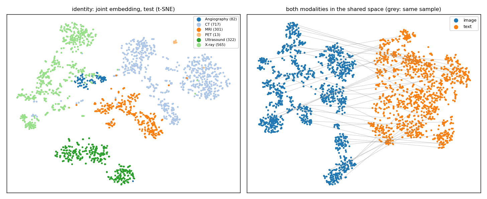
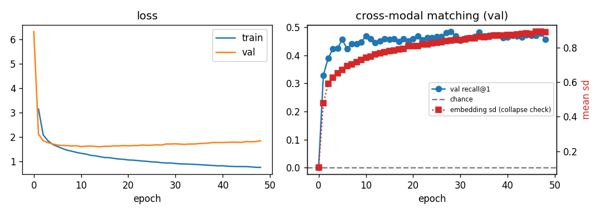

# generated_report_2: ROCOv2 — matching radiology images to captions and naming the imaging modality

**Verdict:** Multimodal enables: the frozen pretrained BiomedCLIP model already links images to captions (correct caption in the top 5 of 2,000 for about 8 in 10 images) and identifies the imaging modality from the image alone (balanced accuracy 0.97); nothing we trained improved on it, so use it as is.

## 1. Summary

- **Question:** Can one shared image–text representation retrieve the right caption for an image (and the reverse) and classify the imaging modality from the image?
- **Approach:** Compared the frozen pretrained BiomedCLIP model, two lightly fine-tuned versions (adapters), a small trained projection model, and simple pixel / word-count baselines; labels were never used for training.
- **Result:** On 2,000 test pairs, the frozen model puts the right caption in the top 5 for 80.8% of images (chance 0.25%) and classifies modality from the image at 0.972 balanced accuracy versus 0.605 for a pixel baseline. The trained projection model retrieves 14 points worse and classifies no differently.
- **Recommendation:** Use the frozen BiomedCLIP image and text embeddings for both tasks; caveat: its pretraining data may overlap this dataset's source.

## 2. Data at a glance

- 24,000 figure–caption pairs from PubMed Central papers (20,000 train / 2,000 validation / 2,000 test; test images come from different papers than train).
- Two modalities: radiology figures (about 70% grayscale) and their captions (median 16 words).
- Six imaging-modality labels (CT, X-ray, MRI, Ultrasound, Angiography, PET). PET is rare (13 test images) and cannot support a conclusion alone.
- Captions give the label away: words alone predict it with balanced accuracy 0.91 (chance 0.17), and 42% of captions name it. Classification is therefore judged on the image side only.

{width=90%}

*Profile of both modalities and the label distribution.*

## 3. Decision path

| # | Step | Decision | Why |
|:---|:------|:------------------|:-------------------------|
| 1 | Goal | Retrieval first, modality classification second | Objective names caption retrieval first; text words nearly give away the label |
| 2 | Data prep | Use BiomedCLIP features plus simple baselines | In-domain pretrained encoder matches radiology figures and captions |
| 3 | Combine modalities | Fine-tune BiomedCLIP with light adapters | Pretrained encoder already aligns both; adapters start from it and can't lose on val |
| 4 | Settings | Gentle adapter training; small projection-head alternative | Zero-shot already matches well; small steps avoid damaging it |
| 5 | Training check | Adapter never beat the starting model | Fine-tuning lowered matching on validation; try gentler step once |
| 6 | Adjust | Retry adapter once at smaller step | Adapter fell below start; skill allows one gentler retry |
| 7 | Training check | MLP heads match worse than zero-shot | Heads trained from scratch lose pretrained alignment |
| 8 | Evaluate | Zero-shot model wins on validation | Training did not improve matching; frozen model is strongest |
| 9 | Downstream | Retrieval and modality classification on test | Objective asks for both; measured on held-out test papers |
| 10 | Recommend | Use frozen BiomedCLIP for both tasks | Nothing we trained beat it; simplest option is best |


The turning point was decision 5: fine-tuning the pretrained model lowered validation matching at every epoch, even with a ten-times smaller step, so the untouched pretrained model was kept.

## 4. Methods compared

- **Pretrained model alone** (BiomedCLIP, frozen): an image encoder and a text encoder pretrained on biomedical figure–caption pairs that already share one space. No training here.
- **Adapter fine-tuning** (two learning rates): small residual layers added on top of the pretrained features, trained with a contrastive loss. Both kept the untouched model because no epoch beat it on validation, so their results are identical to the pretrained model (validation file only; not repeated on test).
- **Trained projection model** (contrastive, small MLPs, no labels): learns a new shared space from the pretrained features, starting from scratch.
- **Baselines:** image alone (pixel PCA), text alone (word-count SVD), and simple combination of both (early fusion). These have no shared space, so retrieval is not defined for them.

Models were chosen on validation; test was run once afterwards.

## 5. Results

| Model (test, n = 2,000) | Retrieval: image→text top-5 | Retrieval: text→image top-5 | Modality classification from image |
|:---|:---|:---|:---|
| Pretrained model alone | 0.808 | 0.808 | 0.972 |
| Trained projection model | 0.667 | 0.673 | 0.974 |
| Image alone (pixel PCA) | – | – | 0.605 |
| Text alone (word counts) | – | – | 0.730 (word-spotting, not image evidence) |
| Early fusion | – | – | 0.694 (joint; includes text) |
| Chance | 0.0025 | 0.0025 | 0.167 |

Paired differences against the pretrained model (95% CI): trained projection model, image→text top-5 −0.141 [−0.158, −0.122]; text→image top-5 −0.135 [−0.154, −0.117]; image classification +0.002 [−0.003, +0.008] (no difference). Pixel baseline image classification −0.367 [−0.391, −0.343].

{width=90%}

*Left: test images and captions combined, coloured by modality; the six classes form separate groups, with X-ray split into several islands. Right: images (blue) and captions (orange) sit in two separate clouds even though paired points are close in rank terms (a "modality gap").*

## 6. Downstream analyses

**Retrieval.** Question: given an image, is its caption among the top candidates (and the reverse)? The pretrained model ranks the true caption first for 49.7% of images, in the top 5 for 80.8% (95% CI 79.1–82.4%) and in the top 10 for 88.2%, out of 2,000 candidates (chance 0.05%, 0.25%, 0.5%). Text→image is similar (top-5 80.8%).

**Modality classification.** Question: can a linear classifier on the image embedding name the modality? Balanced accuracy 0.972 (chance 0.167) vs 0.605 for the pixel baseline. By class on the pretrained image embedding: Ultrasound 1.00, MRI 0.99, Angiography 0.98, CT 0.97, X-ray 0.90 (X-ray is the weakest large class); PET (1.00) has only 13 test images and is uninterpretable.

## 7. Recommendation

Use the **frozen BiomedCLIP** image and text embeddings for both retrieval and modality classification (the exported representation holds the image and text vectors). Deciding numbers: retrieval top-5 0.808 versus 0.667 for the best trained alternative (paired difference −0.141 [−0.158, −0.122] in favour of the pretrained model); classification is statistically indistinguishable (+0.002 [−0.003, +0.008]). Because training gave no gain, the simplest model wins.

Caveats: BiomedCLIP was pretrained on figure–caption pairs from PubMed Central, the same source family as this dataset, so its scores may be inflated by having seen similar or identical pairs (cannot be measured here). Captions reveal the label, so classification from text is not evidence of image understanding. What would change this: evidence that scores collapse on non-PMC radiology data, or an adapter trained on a much larger in-domain set that beats the pretrained model on validation.

## 8. Limitations

- Single 20,000-pair training subset and one seed; adapters were tuned over only two learning rates.
- Retrieval is within 2,000 candidates; real archives are larger and harder.
- Rare classes (PET, n = 13 test) cannot be judged; the labels cover only single-modality figures.
- Possible pretraining overlap (see Recommendation) cannot be ruled out.
- Captions are author-written and may mention several panels, so some "misses" can be near-valid matches.

## Appendix A. Full decision log

1. **Goal** *(objective skill)* — Tasks: image<->text retrieval (primary; recall@1/5/10 both ways, FOSCTTM) and imaging-modality classification from the IMAGE embedding (balanced accuracy, label 'label'). Labels NOT used in training (label-free clip/adapter). Baselines: image alone, text alone, pca_concat early fusion, BiomedCLIP zero-shot. Success: chosen model's paired image->text R@5 gain over zero-shot has CI excluding 0; otherwise recommend zero-shot. Classification judged on image side only.
   - *Evidence:* profile.json: text alone predicts label with bal.acc 0.91 (chance 0.17); 42% of captions name their label; smallest class PET n_train=113 (test 13, uninterpretable alone); test n=2000
   - *Alternatives rejected:* supcon_clip: labels not offered for training; not used
2. **Data prep** *(preprocessing skill)* — image and text: biomedclip (512-d each, shared space) for encoders and zero-shot; image pixels32_pca50 and text tfidf_svd128 as weak baselines
   - *Evidence:* features/*.json: 24000 x 512 / 24000 x 512 / 24000 x 50 / 24000 x 128; fitted on train only
   - *Alternatives rejected:* no caption cleaning (objective doesn't ask)
3. **Combine modalities** *(fusion skill)* — Primary: clip + adapter encoders on biomedclip features, dim 512, select-by val_recall. Alternative: clip with mlp projection heads. Baselines: image-only/text-only pca, pca_concat, identity zero-shot.
   - *Evidence:* fusion skill rule: pretrained shared-space encoder -> adapter
   - *Alternatives rejected:* from-scratch clip on weak features: no pretrained advantage; vicreg: no false-negative concern at n=20000
4. **Settings** *(training skill)* — adapter: clip, dim 512, bs 512, lr 1e-4, select-by val_recall, 8 min. Alternative mlp heads dim 256, lr 1e-3, hidden 256, dropout 0.2, 5 min. Budget total 13 of 20 min, 7 reserved.
   - *Evidence:* smoke: zero-shot val R@1 0.623 at epoch 0; smoke mlp from scratch 0.001->0.019
   - *Alternatives rejected:* larger lr: risks losing pretrained alignment
5. **Training check** *(training skill)* — clip_adapter_d512 kept epoch 0 (kept_initial_model true, 0.26 min); val R@1 fell to 0.576 at epoch 1 while train loss fell: overfitting. One iteration with lr 1e-5.
   - *Evidence:* clip_adapter_d512/run_config.json: val_recall_at_1_initial 0.623, kept 0.623, best_epoch 0
   - *Alternatives rejected:* stop now: allowed, but skill permits one lower-lr retry
6. **Adjust** *(training skill)* — clip_adapter_d512_lr1e5 (lr 1e-5) also kept epoch 0; stop adapter tuning. Adapters therefore equal zero-shot (identical val metrics).
   - *Evidence:* clip_adapter_d512_lr1e5/run_config.json: kept_initial_model true, val R@1 0.623 before and after
   - *Alternatives rejected:* more iterations: rule says stop
7. **Training check** *(training skill)* — clip_mlp_d256: best epoch 28 of 48, early stop; val loss rises after epoch ~10 while train falls (overfitting) but R@1 0.484 vs chance far lower; no collapse.
   - *Evidence:* clip_mlp_d256/run_config.json: initial R@1 0.001, kept 0.484; metrics_val.json: R@5 0.668 vs zero-shot 0.810
   - *Alternatives rejected:* stronger regularisation: would not close a 0.14 gap
8. **Evaluate** *(evaluation skill)* — Choose frozen BiomedCLIP (adapter models are identical to it). Report on test: zero-shot, clip_mlp_d256 (alternative), and the three simple baselines.
   - *Evidence:* comparison_val.md: R@5 img->txt 0.81 vs 0.668 (mlp); image-side probe 0.968 vs 0.969 (mlp); pixels PCA image 0.585; chance R@5 0.0025, probe chance 0.167
   - *Alternatives rejected:* clip_mlp_d256: worse retrieval, equal classification
9. **Downstream** *(recommendation skill)* — Retrieval: zero-shot image->text R@1 0.4965, R@5 0.808 [0.7905,0.824], R@10 0.882 of 2000 candidates (chance R@5 0.0025); text->image R@5 0.8085. Classification from image embedding: probe bal.acc 0.972 vs pixel-PCA image alone 0.605 (paired +0.367 [+0.343,+0.390]); weakest large class X-ray recall 0.904; PET n=13 uninterpretable.
   - *Evidence:* biomedclip_zeroshot/metrics.json; comparison_test_vs_image_only_pca.md; comparison_test_vs_biomedclip_zeroshot.md
   - *Alternatives rejected:* none
10. **Recommend** *(recommendation skill)* — Verdict: multimodal enables (pretrained shared space gives retrieval; classification already ~0.97 from image). Recommend frozen BiomedCLIP image/text embeddings (exported). Trained MLP heads: retrieval R@5 -0.141 [-0.158,-0.122] vs zero-shot; classification +0.002 [-0.003,+0.008] (no difference). Caveat: BiomedCLIP was pretrained on PubMed Central figure-caption pairs (ROCOv2 is also PMC), so zero-shot scores may be inflated by overlap. Would change: an in-domain pretrained-free test set, or a larger lr-tuned adapter gaining on val.
   - *Evidence:* comparison_test_vs_biomedclip_zeroshot.md
   - *Alternatives rejected:* clip_mlp_d256, adapters (identical to zero-shot), pixel/TF-IDF baselines


## Appendix B. Training details

- Adapter (lr 1e-4): batch 512, 20 epochs, early stopped after 0.26 min; best epoch 0 (untouched model), validation top-1 0.623 initially, 0.576 after epoch 1; train loss fell while validation matching fell (overfitting).
- Adapter (lr 1e-5): 0.27 min, best epoch 0; same outcome.
- Projection model (MLP, dim 256, dropout 0.2, lr 1e-3): 48 epochs, best epoch 28, 0.54 min, validation top-1 0.484 (starting 0.001); validation loss rose from about epoch 10 while train loss fell. No collapse (effective rank 27.5 of 256 on test).
- Total training time ≈ 1.1 min of the 20-minute budget (the planned maximum minutes summed to 16).

{width=90%}

*Training and validation loss of the trained projection model.*

## Appendix C. Glossary

- **Recall@k (top-k):** share of queries whose true partner is among the k nearest candidates.
- **Balanced accuracy:** mean per-class recall; not inflated by big classes.
- **Linear probe:** a linear classifier trained on the frozen embedding.
- **Contrastive loss (CLIP):** pulls paired items together and pushes other items in the batch apart.
- **Adapter:** small residual layer starting as the identity, for light fine-tuning.
- **Zero-shot / frozen:** pretrained model used without any training here.
- **Early fusion:** concatenate modalities and reduce with PCA.
- **Paired bootstrap:** resampling the same test items for both models to get a CI for their difference.
- **Modality gap:** image and text embeddings occupy different regions of the shared space.
- **FOSCTTM:** average fraction of candidates ranked closer than the true partner (0 perfect, 0.5 random).

## Appendix D. Reproduce

Tool calls in the order the agent ran them (smoke tests and --help omitted):

```bash
python3 tools/inspect_data.py --data data/rocov2 --out outputs/generated_report_2_rocov2
python3 tools/preprocess.py --data data/rocov2 --out outputs/generated_report_2_rocov2 --modality image --spec biomedclip
python3 tools/preprocess.py --data data/rocov2 --out outputs/generated_report_2_rocov2 --modality text --spec biomedclip
python3 tools/preprocess.py --data data/rocov2 --out outputs/generated_report_2_rocov2 --modality image --spec pixels32_pca50
python3 tools/preprocess.py --data data/rocov2 --out outputs/generated_report_2_rocov2 --modality text --spec tfidf_svd128
python3 tools/train.py --data data/rocov2 --out outputs/generated_report_2_rocov2/image_only_pca --inputs image:pixels32_pca50 --method pca_concat --dim 32 --max-minutes 1
python3 tools/train.py --data data/rocov2 --out outputs/generated_report_2_rocov2/text_only_pca --inputs text:tfidf_svd128 --method pca_concat --dim 32 --max-minutes 1
python3 tools/train.py --data data/rocov2 --out outputs/generated_report_2_rocov2/early_fusion_pca --inputs image:pixels32_pca50,text:tfidf_svd128 --method pca_concat --dim 32 --max-minutes 1
python3 tools/train.py --data data/rocov2 --out outputs/generated_report_2_rocov2/biomedclip_zeroshot --inputs image:biomedclip,text:biomedclip --method identity --max-minutes 1
python3 tools/train.py --data data/rocov2 --out outputs/generated_report_2_rocov2/clip_adapter_d512 --inputs image:biomedclip,text:biomedclip --method clip --encoder adapter --dim 512 --batch-size 512 --lr 1e-4 --select-by val_recall --max-minutes 8
python3 tools/train.py --data data/rocov2 --out outputs/generated_report_2_rocov2/clip_adapter_d512_lr1e5 --inputs image:biomedclip,text:biomedclip --method clip --encoder adapter --dim 512 --batch-size 512 --lr 1e-5 --select-by val_recall --max-minutes 3
python3 tools/train.py --data data/rocov2 --out outputs/generated_report_2_rocov2/clip_mlp_d256 --inputs image:biomedclip,text:biomedclip --method clip --encoder mlp --dim 256 --hidden 256 --dropout 0.2 --batch-size 512 --lr 1e-3 --select-by val_recall --max-minutes 5
python3 tools/evaluate.py --data data/rocov2 --run outputs/generated_report_2_rocov2/biomedclip_zeroshot --split val --tasks structure,retrieval,collapse
python3 tools/evaluate.py --data data/rocov2 --run outputs/generated_report_2_rocov2/clip_mlp_d256 --split val --tasks structure,retrieval,collapse
python3 tools/evaluate.py --data data/rocov2 --run outputs/generated_report_2_rocov2/clip_adapter_d512 --split val --tasks structure,retrieval,collapse
python3 tools/evaluate.py --data data/rocov2 --run outputs/generated_report_2_rocov2/image_only_pca --split val --tasks structure,collapse
python3 tools/evaluate.py --data data/rocov2 --run outputs/generated_report_2_rocov2/text_only_pca --split val --tasks structure,collapse
python3 tools/evaluate.py --data data/rocov2 --run outputs/generated_report_2_rocov2/early_fusion_pca --split val --tasks structure,collapse
python3 tools/compare_runs.py --out outputs/generated_report_2_rocov2 --split val
python3 tools/evaluate.py --data data/rocov2 --run outputs/generated_report_2_rocov2/biomedclip_zeroshot --split test --tasks structure,retrieval,collapse
python3 tools/evaluate.py --data data/rocov2 --run outputs/generated_report_2_rocov2/clip_mlp_d256 --split test --tasks structure,retrieval,collapse
python3 tools/evaluate.py --data data/rocov2 --run outputs/generated_report_2_rocov2/image_only_pca --split test --tasks structure,collapse
python3 tools/evaluate.py --data data/rocov2 --run outputs/generated_report_2_rocov2/text_only_pca --split test --tasks structure,collapse
python3 tools/evaluate.py --data data/rocov2 --run outputs/generated_report_2_rocov2/early_fusion_pca --split test --tasks structure,collapse
python3 tools/compare_runs.py --out outputs/generated_report_2_rocov2 --split test --reference biomedclip_zeroshot
python3 tools/compare_runs.py --out outputs/generated_report_2_rocov2 --split test --reference image_only_pca
```

