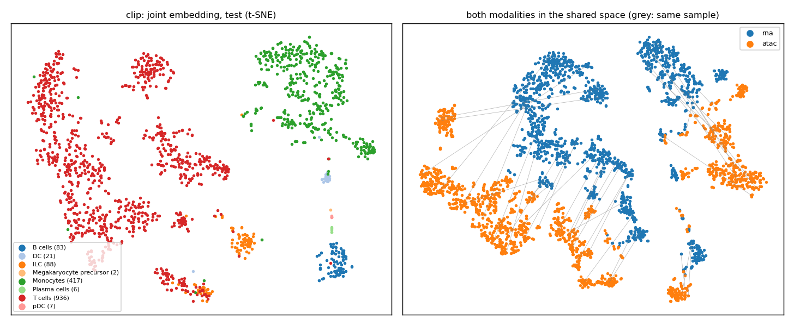
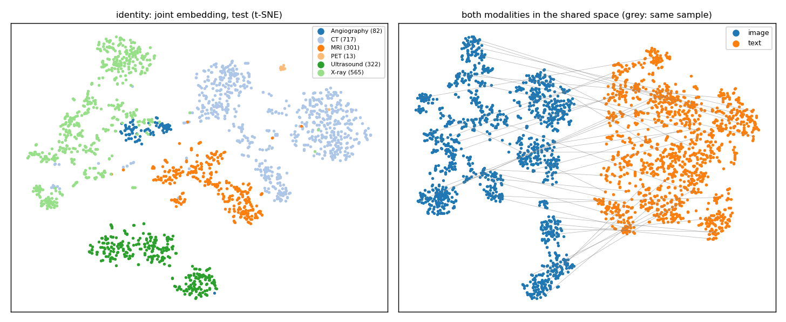

---
header-includes:
- \usepackage{float}
- \floatplacement{figure}{H}
output: pdf_document
---

# Building an AI Agent for Multimodal Representation Learning

## 1. System Architecture Overview

Biomedical studies increasingly measure the same sample in several ways: a cell's RNA *and* its chromatin, a scan *and* its caption. Which preprocessing suits each modality, whether to fuse or align them, whether to train an encoder or reuse a pretrained one, and whether the second modality helps at all depend on both the data and the user's goal. This project builds an AI agent that makes these decisions itself: given a multimodal dataset and a plain-language objective, a large language model (LLM) inspects each modality, interprets the objective, chooses preprocessing, fusion strategy, encoders and training objective, trains, evaluates against baselines, runs the requested downstream analyses, recommends a representation and writes the report. The design keeps the two-layer structure of Projects 1 and 2 (Figure 1).

{width="92%"}

**Decision layer.** `AGENTS.md` defines the workflow (inspect → interpret objective → preprocess → choose fusion and method → configure → train and check → evaluate on validation → iterate → test → downstream analyses → recommend → report) and a few hard rules. Six skill files hold the *criteria* for each decision: objective, preprocessing, fusion, training, evaluation and recommendation. They are written in terms of evidence (for example "at least 70% of non-zero counts are at most 2 → treat as near-binary"), never in terms of a dataset name: the words "PBMC" and "ROCOv2" appear in none of them.

**Compute layer** (`tools/`, no decision logic). `inspect_data.py` profiles each modality; `preprocess.py` turns one modality into a feature matrix from a short specification (e.g. `tfidf_lsi50_drop1`); `train.py` learns the representation; `evaluate.py` scores it; `compare_runs.py` compares models, including *paired* differences against a reference; `export_representation.py` saves the recommended representation. `log_decision.py` records each decision with its evidence and rejected alternatives; the report's decision table and "Reproduce" commands are generated from that log.

**A common data format** makes the tools dataset-agnostic: each dataset's `prepare.py` writes a manifest (`dataset.json`), one row per sample (`obs.csv`, with split and labels) and one file per modality of kind *counts*, *image* or *text*. Only `prepare.py` is dataset-specific.

Four rules keep the system honest and reusable: (1) the agent may never edit `tools/`; (2) every reported number must come from a file a tool wrote; (3) **fit on train, choose on validation, report on test** — the agent compares candidates with `--split val` and runs the test split only on the models that go in the report; (4) every learned representation is judged next to each modality alone and simple early fusion (plus the pretrained zero-shot model when one exists).

## 2. Agent Decision-Making

**Interpret the objective.** The objective skill maps the user's wording to downstream tasks and their headline metrics: "identify cell types" → a linear classifier on the embedding (balanced accuracy); "retrieve the matching caption" → cross-modal retrieval (recall@k); "predict one modality from the other" → regression from one modality's embedding to the other's features. It also fixes a **label policy**: labels are a yardstick first and are used for training (supervised contrastive learning) only if the objective allows it. It checks *how* the labels were made (PBMC labels were predicted from RNA alone, which caps what ATAC can add) and whether a label can be read off the text (a classifier on caption words alone predicts ROCOv2's imaging modality with 0.91 balanced accuracy, so classification is judged from the image side). 

**Preprocess from evidence.** The preprocessing skill decides from the profile, not from the modality's name. Overdispersed counts spread over many values (RNA-like) get library-size normalisation, log1p, 2,000 variable features and PCA; near-binary sparse counts (ATAC-like: in PBMC, 72% of non-zero peak counts are at most 2 because 10x counts both ends of each fragment) get TF-IDF and latent semantic indexing, and the first component is dropped only if it tracks sequencing depth (it did: r = 0.86). Images and captions use a pretrained encoder when its training data match the domain (BiomedCLIP for biomedical figures), with deliberately simple baselines (32×32 pixels; word TF-IDF) to show what pretraining buys.

**Choose how to combine modalities.** The fusion skill maps the lecture methods to situations: early fusion (concatenate, then PCA) as a baseline; **CLIP-style contrastive alignment** (symmetric InfoNCE between one encoder per modality) when samples are paired and the objective needs a shared space; **VICReg** (no negatives) when many samples look alike or data are small; **supervised contrastive** learning only when labels are allowed; **SimCLR** for one modality; and **light fine-tuning of a pretrained model** with a residual *adapter* that starts exactly at the pretrained features. The agent picks one primary method and at most one alternative.

**Train and check health.** The training skill gives starting settings and health checks read from the training log: overfitting, collapse (embedding variance → 0), matching at chance, and whether training beat its starting point. Every learned run also scores *epoch 0*, the model before any update, and keeps it unless a later epoch is better on the chosen criterion (validation loss, or validation recall for retrieval objectives), so an adapter can never end below the pretrained model it starts from.

**Evaluate, compare and recommend.** The evaluation skill chooses the tasks that measure the objective and interprets every number next to its chance level and baseline. "Is A better than B?" is answered by a **paired bootstrap** of the difference (both models scored on the same test samples, resampled together) — never by whether two separate confidence intervals overlap — and the size of a difference is judged as well as its sign. The recommendation skill forces one of four verdicts (*multimodal helps*, *enables*, *no measurable gain*, *can't tell*), prefers the simplest representation tied with the best, and lists the caveats that change how to use it.

## 3. Tools and Models

**Language model.** Claude Sonnet 5.5, run non-interactively through Claude Code (`claude -p`) by `run_agent.sh`. It makes every analytical decision and writes the generated reports, using only shell and file tools.

**Representation learning** is implemented in PyTorch: per-modality linear, MLP or residual-adapter encoders trained with CLIP-style InfoNCE (learnable temperature), VICReg, supervised contrastive + InfoNCE, or SimCLR (feature masking and noise as augmentations). **Pretrained model:** BiomedCLIP (ViT-B/16 image encoder and PubMedBERT text encoder, pretrained on PubMed Central figure–caption pairs) through OpenCLIP, used frozen as a zero-shot baseline and as the starting point for fine-tuning. **Evaluation** uses scikit-learn (logistic-regression probes, k-NN, k-means, ridge regression for cross-modal prediction) and paired bootstrap intervals. **Data preparation:** `scanpy`, CellTypist immune reference models (PBMC cell-type labels) and Pillow. Everything runs on an Apple-silicon laptop GPU; one agent run took about 5 minutes and US$0.50.

## 4. Experimental Results

*(Full decision logs, metrics, training curves and commands: `generated_report_1` and `generated_report_2`.)*

|  | Report 1: PBMC Multiome | Report 2: ROCOv2 |
|:-----------------|:-----------------|:-----------------|
| Data | 10,405 cells; RNA (25,598 genes) + ATAC (111,698 peaks) | 24,000 radiology figures + captions |
| Objective | Identify cell types; predict each modality from the other | Caption-to-image and image-to-caption retrieval; modality from the image |
| Method chosen | CLIP-style contrastive (VICReg alternative) | Adapter fine-tuning of BiomedCLIP (MLP heads alternative) |
| Iteration | CLIP overfit: regularised, val. fine-type acc. 0.83 → 0.90 | Adapter never beat its start; retry at 10× lower learning rate, same |
| Deciding numbers (test) | Fine types 0.884 vs 0.831 RNA alone: +0.053 [+0.016, +0.086]; vs early fusion +0.035 [-0.001, +0.074] | Zero-shot top-5 retrieval 0.81 (chance 0.0025); MLP heads -0.141 [-0.158, -0.122] |
| Verdict | Multimodal helps; early fusion near-equal and simpler | Multimodal enables; training adds nothing: use frozen BiomedCLIP |

**Table 1**: What the agent decided on each run. Brackets: 95% paired bootstrap intervals.

**PBMC Multiome (paired RNA + ATAC).** The agent rejected supervised contrastive learning because the objective did not grant labels for training, and chose CLIP-style alignment because cells are paired and cross-modal prediction needs a shared space, with VICReg as the alternative ("many same-type cells look alike"). The turning point was the training check: the first CLIP model peaked at epoch 11 and on validation fell below simple early fusion (0.83 vs 0.88 fine-type balanced accuracy); a smaller, more regularised network raised it to 0.90 and was chosen. On test, the joint embedding identified the 17 fine cell types better than either modality alone (+0.05 for both, paired intervals excluding 0) — notable because the labels came from RNA — but was statistically tied with early fusion, which the agent named as the simpler alternative. It also reported what did *not* work: RNA→ATAC prediction was barely above the average-profile baseline (per-cell AUROC 0.671 vs 0.661), the largest class (helper T cells, 573 test cells) was recognised only 61% of the time in every representation, and the joint embedding clustered *worse* than RNA alone (k-means ARI 0.28 vs 0.43) despite better linear separability. Single cells were nevertheless matched across modalities far above chance (true partner among the top 5 of 1,560 for 28% of cells; chance 0.3%) (Figure 2).

{width="68%"}

**ROCOv2 (radiology images + captions).** Zero-shot BiomedCLIP already retrieved the right caption among the top 5 of 2,000 for 81% of test images and classified modality from the image with 0.972 balanced accuracy, versus 0.605 for the pixel baseline. The agent chose light fine-tuning with an adapter, selecting epochs by validation retrieval. Training lowered the batch loss but made retrieval worse from the first epoch, so the epoch-0 rule kept the untouched pretrained model; the agent retried once with a 10× smaller learning rate, saw the same, and stopped, as the training skill prescribes. Fresh projection heads on the same features were clearly worse at retrieval (-0.141 top-5) and equal at classification. The agent therefore recommended the frozen model — a negative result for training, reached with evidence — and flagged that BiomedCLIP was pretrained on the same source (PubMed Central) as ROCOv2, so its scores may be inflated by overlap that the tools cannot measure. X-ray was the weakest large class (recall 0.90 on 565 images). Figure 3 shows the *modality gap*: images and captions form two separate clouds, yet retrieval works because the gap is a shared offset that leaves each image's ranking of captions unchanged.

{width="68%"}

## 5. Strengths and Limitations

**Strengths.** The system is autonomous from one command: given a dataset, an objective and a budget, it decides how to preprocess, combine, train and judge, and the same skills led to different choices for the right reasons: different preprocessing for two count modalities, alignment learned from scratch for cells but a pretrained foundation model for figures, and verdicts of "helps" vs "enables, but training adds nothing". Its evaluation resists over-optimism: every learned model must beat single-modality, early-fusion and zero-shot baselines; comparisons use paired intervals; model choice uses validation data only; and the agent reached negative conclusions ("RNA→ATAC prediction is weak", "fine-tuning adds nothing") and reported them plainly. Every number traces to a file, each report ends with the commands to reproduce it, and three runs of PBMC gave identical test numbers. A new dataset needs only a `prepare.py` that writes the common format.

**Limitations.** (1) *Scope*: modalities must be counts, images or text (clinical tables would need a new kind); learned methods align exactly two paired modalities; BiomedCLIP is the only pretrained encoder; robustness was shown on two datasets only. (2) *Yardsticks*: PBMC labels were predicted from RNA; ROCOv2 scores may be inflated by pretraining overlap; tiny classes (2–13 test samples) cannot be judged. (3) *Statistics*: one seed per configuration, so close differences (CLIP vs early fusion) may shift. (4) *The agent*: LLM decisions are not fully repeatable (two ROCOv2 runs labelled the same evidence "enables" and "no measurable gain"), and conclusions are only as good as the tools — reviewing early reports exposed two tool flaws (unpaired intervals; an adapter that could not keep its start), since fixed.

## References

- Chen T. et al. (2020). A simple framework for contrastive learning of visual representations (SimCLR). *ICML*.
- Bardes A., Ponce J., LeCun Y. (2022). VICReg: Variance-invariance-covariance regularization for self-supervised learning. *ICLR*.
- Khosla P. et al. (2020). Supervised contrastive learning. *NeurIPS*.
- Radford A. et al. (2021). Learning transferable visual models from natural language supervision (CLIP). *ICML*.
- Zhang S. et al. (2023). BiomedCLIP: a multimodal biomedical foundation model pretrained from fifteen million scientific image-text pairs. *arXiv:2303.00915*.
- Rückert J. et al. (2024). ROCOv2: Radiology Objects in COntext version 2. *Scientific Data* 11:688.
- Domínguez Conde C. et al. (2022). Cross-tissue immune cell analysis reveals tissue-specific features in humans (CellTypist). *Science* 376:eabl5197.
- Wang T., Isola P. (2020). Understanding contrastive representation learning through alignment and uniformity on the hypersphere. *ICML*.
- Liang W. et al. (2022). Mind the gap: understanding the modality gap in multi-modal contrastive representation learning. *NeurIPS*.
- 10x Genomics (2021). 10k Human PBMCs, Multiome v1.0, Chromium X (Cell Ranger ARC 2.0.0). Public dataset.
